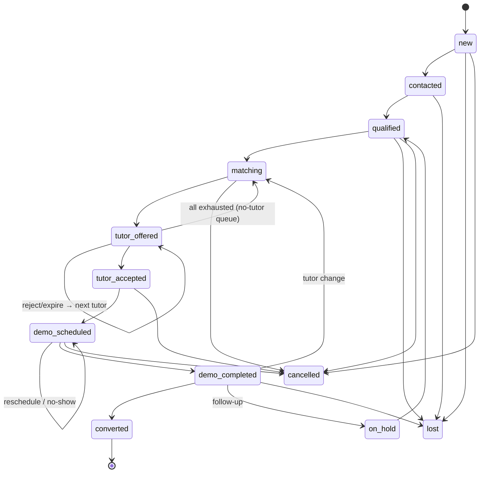
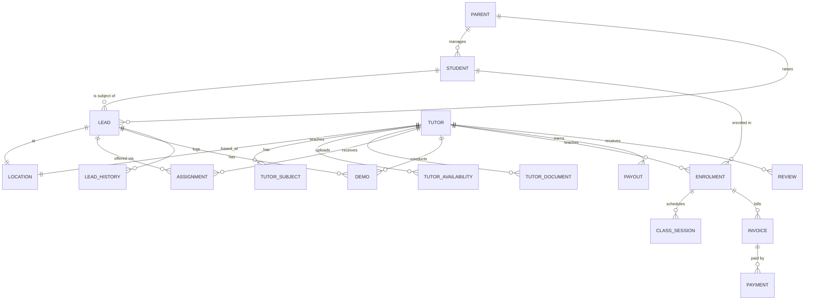
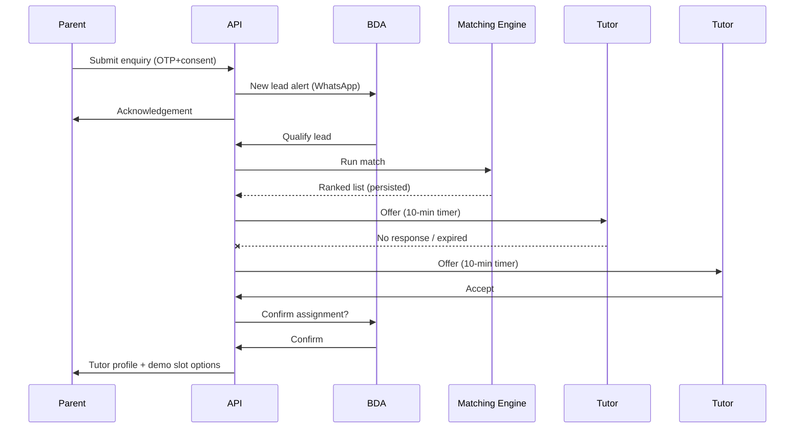

# VidhyaGharSe ("home tution") — Complete Product & Engineering Blueprint

> **Purpose of this file.** This is the single source of truth for designing and (re)building the application. It covers:
> 1. **What exists today** in this repository — every page, section, field, button, API route, service, formula, config and script, with its actual behaviour.
> 2. **What the product must become** — the full target specification from the business requirements document `VidhyaGharSe_Home_Online_Tuition_Complete_Developer_Requirements (3).docx` (v1.0, dated 29 Aug 2026), turned into screens, buttons, data models, APIs, state machines and rules.
> 3. **The gap between the two**, including bugs found while reading the code, so nothing gets carried over by accident.
>
> **Legend used throughout**
>
> | Tag | Meaning |
> |---|---|
> | ✅ **Built** | Implemented and works in the current code (possibly with mock data) |
> | 🟡 **Mock / Stub** | UI or route exists but uses hard-coded data, or returns a placeholder |
> | ❌ **Missing** | Required by the spec, not present in code |
> | 🐞 **Bug** | Present in code but behaves incorrectly |
> | **P0 / P1 / P2** | Priority from the requirements doc (P0 = must-have MVP, P1 = MVP-desirable, P2 = Phase 2) |
>
> File references use `path:line` relative to the repository root.

---

## Table of Contents

1. [Product Overview & Vision](#1-product-overview--vision)
2. [Branding & Naming](#2-branding--naming)
3. [Current Implementation Status (at a glance)](#3-current-implementation-status-at-a-glance)
4. [Tech Stack](#4-tech-stack)
5. [Repository Structure](#5-repository-structure)
6. [User Roles & Permission Matrix](#6-user-roles--permission-matrix)
7. [Design System (UI Tokens, Components, Buttons, Motion)](#7-design-system)
8. [Sitemap & Routes](#8-sitemap--routes)
9. [Screen Specifications — Current (as built)](#9-screen-specifications--current-as-built)
10. [Screen Specifications — Target (full product)](#10-screen-specifications--target-full-product)
11. [Form Field Dictionaries](#11-form-field-dictionaries)
12. [State Machines & Lifecycles](#12-state-machines--lifecycles)
13. [Geo-Matching & Assignment Engine](#13-geo-matching--assignment-engine)
14. [Data Model](#14-data-model)
15. [API Specification](#15-api-specification)
16. [Notifications, WhatsApp & Email](#16-notifications-whatsapp--email)
17. [Admin Configuration Panel & Master Data](#17-admin-configuration-panel--master-data)
18. [Dashboards, KPIs & Reports](#18-dashboards-kpis--reports)
19. [Payments, Billing & Payouts](#19-payments-billing--payouts)
20. [Home-Tuition Operations](#20-home-tuition-operations)
21. [Online Tuition / LMS Module](#21-online-tuition--lms-module)
22. [Ratings, Reviews & Quality](#22-ratings-reviews--quality)
23. [Security, Privacy & Compliance](#23-security-privacy--compliance)
24. [Business Rules (must-enforce)](#24-business-rules-must-enforce)
25. [End-to-End Workflows](#25-end-to-end-workflows)
26. [Environment Variables](#26-environment-variables)
27. [Running, Ports & Deployment](#27-running-ports--deployment)
28. [Known Bugs & Gaps in Current Code](#28-known-bugs--gaps-in-current-code)
29. [Roadmap, MVP vs Phase 2, Acceptance Criteria](#29-roadmap-mvp-vs-phase-2-acceptance-criteria)
30. [Testing Checklist](#30-testing-checklist)
31. [Open Decisions](#31-open-decisions)

---

## 1. Product Overview & Vision

**VidhyaGharSe** (company: *VidhyaGharSe Learning Innovations Private Limited*) is a **home-tuition and online-tuition platform** that connects parents/students with verified tutors. It is not just an enquiry website — it is an **end-to-end education operations platform**:

```
Lead generation → Parent registration → Requirement qualification → Geo-based tutor matching
→ Tutor acceptance → Demo → Conversion → Class delivery → Attendance → Learning progress
→ Payments → Tutor payout → Feedback → Renewal
```

### 1.1 Primary operating model (10 steps)
1. Parent/student submits an enquiry **or** a BDA (Business Development Associate) creates a lead.
2. System captures student requirement, preferred location, schedule and learning mode.
3. System geocodes the address/pincode and calculates tutor proximity.
4. Matching engine ranks eligible tutors by distance + subject + class + board + availability + experience + performance.
5. Lead is offered to tutors **in sequence or in controlled batches**; tutor accepts/rejects within a configurable time window.
6. Operations/BDA confirms the tutor and schedules a demo.
7. After the demo, the parent chooses **proceed / hold / reject**.
8. Converted student becomes an **active enrolment** with recurring classes, attendance, fee tracking and support.
9. Online students receive LMS / live class / assignment / test capabilities.
10. Management gets dashboards for leads, tutors, revenue, conversions, operations and quality.

### 1.2 Product modules & priority

| Module | Purpose | Priority | Current state |
|---|---|---|---|
| Parent & Student | Registration, enquiry, requirements, communication, payments, feedback | P0 | 🟡 Register form + mock dashboard |
| Tutor / Mentor | Registration, KYC, subjects, service area, availability, accept/reject leads | P0 | 🟡 Register form + mock dashboard |
| Lead Management | Capture, qualification, follow-up, source, status, assignment | P0 | 🟡 Lead created on parent registration; admin list is mock |
| Geo Matching Engine | Location-based tutor discovery and ranking | P0 | 🟡 Scoring algorithm built; runs on hard-coded tutors |
| Demo Management | Scheduling, reminders, outcome, conversion | P0 | 🟡 Stub routes only |
| Home Tuition Operations | Assignment, classes, attendance, substitution, support | P0 | 🟡 Stub routes only |
| Online Tuition | Live classes, recordings, assignments, tests, materials | P0 | ❌ |
| Payments & Fees | Invoices, receipts, subscriptions/instalments, tutor payout | P1 | 🟡 Stub routes; mock UI |
| WhatsApp Automation | Lead alerts, reminders, confirmations, follow-ups | P0 | ❌ |
| CRM / Admin | BDA workflow, pipeline, dashboards, reports | P0 | 🟡 Mock admin dashboard |
| Ratings & Quality | Reviews, tutor performance, complaints | P1 | ❌ (ratings displayed as mock numbers) |
| Analytics | Funnel, geography, tutor utilisation, revenue | P1 | ❌ |

---

## 2. Branding & Naming

| Item | Requirements doc | Current code | Decision needed |
|---|---|---|---|
| Product name | **VidhyaGharSe** | `home tution` (lower-case, misspelt "tution") everywhere: nav logo, titles, emails, package names | Rename everywhere to the final brand; the misspelling appears in UI, `<title>`, emails, container names |
| Support email | — | `support@hometution.com` (README) | Confirm |
| Sender email | — | `noreply@hometution.com` | Confirm domain |
| Tagline (landing) | — | "Find the Perfect Tutor Near You" | Keep / revise |
| Primary city for test data | Hyderabad (doc §26, §31) | Mock coordinates 17.3850, 78.4867 (Hyderabad) | Consistent |
| Currency | INR | ₹ | Consistent |
| Country restriction | India | Places autocomplete restricted to `country:in` | Consistent |

Where the text below says "brand", substitute the final name.

---

## 3. Current Implementation Status (at a glance)

| Area | Status | Notes |
|---|---|---|
| Landing page `/` | ✅ | Animated hero, features, how-it-works, CTA, footer |
| Parent registration `/parent/register` | ✅ UI / 🐞 | 4-step form; posts to API; review step is empty; no OTP; no per-step validation |
| Tutor registration `/tutor/register` | ✅ UI / 🐞 | 2-step form; no photo, documents, availability, bio, consent |
| Parent dashboard `/parent/dashboard` | 🟡 | 6 tabs, all hard-coded data; no auth |
| Tutor dashboard `/tutor/dashboard` | 🟡 | 5 tabs, hard-coded; accept/reject only change local state |
| Admin dashboard `/admin/dashboard` | 🟡 | 5 tabs; verify & config edit are local-only (`alert()`) |
| Login pages `/parent/login`, `/tutor/login` | ❌ | Linked from register pages → 404 |
| Backend API (Express) | 🟡 | 9 routers; only parent register, tutor register, OTP, matching and config endpoints have real logic |
| Database | 🟡 | `backend/src/config/catalyst.js` is an **in-memory** object named "CatalystDB"; data lost on restart |
| Auth | 🟡 | OTP (logged to console) + JWT; no middleware protects any route |
| Geocoding | ✅ (needs key) | Google Geocoding API; registration fails without `GOOGLE_MAPS_API_KEY` |
| Matching engine | ✅ algorithm / 🟡 data | 7-factor weighted score; runs on 2 hard-coded tutors |
| Email | 🟡 | Nodemailer + Zoho SMTP templates written; calls commented out |
| WhatsApp, SMS, payments gateway, LMS, file uploads, audit log, tests | ❌ | |
| Docker / multi-port scripts | 🟡 / 🐞 | See §27, §28 |

---

## 4. Tech Stack

### 4.1 Current (in repo)

| Layer | Technology | Version (package.json) |
|---|---|---|
| Frontend framework | Next.js (App Router, `app/` dir), React | next ^14.0.0, react ^18.2.0 |
| Styling | Tailwind CSS + PostCSS + Autoprefixer, custom `globals.css` | tailwindcss ^3.3.0 |
| Animation | Framer Motion | ^10.16.0 |
| Forms | react-hook-form | ^7.48.0 |
| HTTP client | axios | ^1.4.0 |
| Icons | react-icons (Feather set `react-icons/fi`) | ^4.12.0 |
| Utils | date-fns ^2.30.0, clsx ^2.0.0 (installed, unused) | |
| Backend | Node.js ≥16, Express ^4.18.2 | |
| Backend libs | dotenv, cors, helmet, jsonwebtoken, bcryptjs (unused), uuid, axios, nodemailer, googleapis (unused) | |
| Dev | nodemon, jest (no tests), eslint + eslint-config-next | |
| DB (intended) | Zoho Catalyst Datastore (currently in-memory mock) | |
| Email | Zoho Mail SMTP (`smtp.zoho.in:465`) via Nodemailer | |
| Maps | Google Geocoding API, Google Places Autocomplete | |
| Calendar (intended) | Google Calendar API (env vars only) | |
| Containers | Docker (node:18-alpine), docker-compose | |

### 4.2 Recommended target architecture (requirements doc §19)

| Concern | Recommendation | Notes |
|---|---|---|
| Web admin portal | React / Next.js | Keep current Next.js |
| Parent/tutor mobile | Responsive web / **PWA**, or React Native / Flutter | Mobile-first is mandatory for parent form |
| Backend | Node.js / NestJS, Django, Laravel or equivalent | Current Express can stay; NestJS gives modules/guards |
| Database | **PostgreSQL** | Requirements doc recommends; current code targets Zoho Catalyst — **conflict, decide (§31)** |
| Geo DB | **PostGIS** (geography POINT + spatial index) | |
| Cache / queues | **Redis** (OTP store, offer-expiry timers, job queues e.g. BullMQ) | |
| File storage | S3-compatible object storage (KYC docs, photos, materials, recordings) | |
| Maps / geocoding | Google Maps / Mapbox | Road distance via Distance Matrix where practical |
| Auth | OTP + secure session / JWT; Admin 2FA recommended | |
| Payments | Indian gateway e.g. **Razorpay** (or compliant provider) | MVP may be manual recording |
| Messaging | WhatsApp Business API provider + SMS + email | |
| LMS | External (e.g. Graphy) or custom | Keep CRM/lead/geo in custom layer |
| Analytics | BI dashboard + event tracking | |

> The doc explicitly states the stack is the team's choice; **functional requirements and data contracts must remain stable**.

---

## 5. Repository Structure

```
edTech/
├── PROJECT_BLUEPRINT.md          ← this file
├── README.md                     # overview, endpoints, matching formula
├── SETUP.md                      # local setup, credentials, table list
├── PROGRESS.md                   # checklist (states dashboards 0% – outdated; they now exist as mocks)
├── DOCKER.md                     # Docker usage guide
├── RUN_MULTI_PORT.md             # multi-port guide
├── .env.example                  # env template (see §26)
├── .env.ports                    # port map 5000/3000/3001/3002/3003
├── docker-compose.yml            # backend + frontend
├── docker-compose.multi.yml      # backend + 4 frontend containers (same image)
├── start-multi-local.sh          # starts 5 local processes (hard-coded macOS path)
├── start-multi-docker.sh         # docker variant
├── VidhyaGharSe_..._Requirements (3).docx   # business requirements (source for §10+)
├── backend/
│   ├── Dockerfile, .dockerignore, package.json
│   └── src/
│       ├── index.js              # Express app, middleware, route mounting, error handler
│       ├── config/catalyst.js    # in-memory DB singleton
│       ├── services/
│       │   ├── authService.js    # OTP + JWT
│       │   ├── geoService.js     # geocode, haversine, nearby, autocomplete
│       │   ├── matchingService.js# scoring + ranking
│       │   └── emailService.js   # 4 email templates
│       └── routes/  auth, parents, tutors, leads, demos, classes, enrolments, payments, admin
└── frontend/
    ├── Dockerfile, .dockerignore, package.json
    ├── next.config.js, tailwind.config.js, postcss.config.js
    └── app/
        ├── layout.jsx, globals.css, page.jsx (landing)
        ├── parent/register/page.jsx, parent/dashboard/page.jsx
        ├── tutor/register/page.jsx,  tutor/dashboard/page.jsx
        └── admin/dashboard/page.jsx
```

Folders referenced in README but **not present**: `frontend/components/`, `frontend/lib/`, `frontend/styles/`, `frontend/public/`, `backend/src/models/`, `backend/src/middleware/`, `admin/`.

---

## 6. User Roles & Permission Matrix

### 6.1 Roles (requirements doc §3)

| Role | Main permissions |
|---|---|
| **Super Admin** | Everything; configuration; users; financial and system settings |
| **Operations Manager** | Leads, tutor matching, assignments, demos, escalations |
| **BDA** | Create/manage leads, follow-ups, calls, demos, conversion pipeline |
| **Tutor / Mentor** | Own profile, availability, assigned leads, classes, attendance, notes, earnings |
| **Parent** | Student profiles, requirements, tutor details *after approval*, schedule, fees, feedback |
| **Student** | Classes, assignments, tests, attendance, materials, profile |
| **Finance** | Invoices, collections, refunds, tutor payouts, reports |
| **Support** | Tickets, complaints, rescheduling, communication history |
| **Content / LMS Admin** | Courses, subjects, materials, tests, recordings |

Current code: role is a free string sent by the client in `POST /api/auth/verify-otp` (`role` or `userType`) — 🐞 must be server-determined. No route checks role.

### 6.2 Detailed permission matrix (target)

Legend: **C**reate **R**ead **U**pdate **D**elete/Archive, **own** = only own records, **—** = no access.

| Resource | Super Admin | Ops Mgr | BDA | Tutor | Parent | Student | Finance | Support | LMS Admin |
|---|---|---|---|---|---|---|---|---|---|
| Users & roles | CRUD | R | — | — | — | — | — | R | — |
| Parents | CRUD | RU | CRU | R (masked until accepted) | RU own | — | R | R | — |
| Students | CRUD | RU | CRU | R assigned | CRU own | R own | R | R | R |
| Leads | CRUD | CRU | CRU (own queue) | R offered (masked) | C, R own | — | — | R | — |
| Matching run / override | ✓ | ✓ | run only | — | — | — | — | — | — |
| Assignments / offers | CRUD | CRU | R | accept/reject own | R accepted tutor | — | — | R | — |
| Tutors (profile) | CRUD | RU | R | RU own | R approved tutor (public profile) | R assigned | R | R | — |
| Tutor KYC documents | R/verify | R/verify | — | CU own | — | — | — | — | — |
| Tutor bank details | R (audited) | — | — | CU own | — | — | R (audited) | — | — |
| Demos | CRUD | CRUD | CRU | RU own (outcome notes) | R, reschedule own | R | — | RU | — |
| Enrolments | CRUD | CRU | C (convert) | R own | R own | R own | R | R | — |
| Class sessions & attendance | CRUD | CRUD | R | CRU own | R + acknowledge | R | — | R | R |
| Invoices | CRUD | R | R | — | R own | — | CRUD | R | — |
| Payments / refunds | CRUD | R | — | — | C (pay) R own | — | CRUD | R | — |
| Payouts | CRUD | R | — | R own | — | — | CRUD | — | — |
| Tickets | CRUD | CRU | CR | CR own | CR own | CR own | R | CRUD | — |
| Reviews/ratings | CRUD | R | R | R own, self-report | C own | C own | — | R | — |
| LMS content | CRUD | R | — | CRU own course | R | R | — | — | CRUD |
| Config & masters | CRUD | R | — | — | — | — | fee/commission R | ticket SLA R | subjects R |
| Notification templates | CRUD | R | — | — | — | — | — | R | — |
| Audit logs | R | R (ops scope) | — | — | — | — | R (finance scope) | — | — |
| Reports | All | Ops/lead/geo/tutor | Own BDA | Own earnings | — | — | Finance | Quality | Learning |

---

## 7. Design System

### 7.1 Colour tokens (current)

| Token | Value | Usage |
|---|---|---|
| `primary` (tailwind) | `#3b82f6` (blue-500) | Defined; most code uses `blue-600` directly |
| `secondary` (tailwind) | `#8b5cf6` (violet-500) | Defined |
| Brand gradient | `linear-gradient(135deg, #3b82f6 0%, #8b5cf6 100%)` | `.gradient-text` logo/headings |
| Hero gradient | `linear-gradient(135deg, #667eea 0%, #764ba2 100%)` | `.hero-gradient` landing hero |
| CTA band | `from-blue-600 to-purple-600` | Landing CTA |
| Parent accent | Blue (`blue-600`, bg `from-blue-50 to-indigo-100`) | Parent register |
| Tutor accent | Purple (`purple-600`, bg `from-purple-50 to-indigo-100`) | Tutor register |
| Body text | `#1a1a1a`; secondary `gray-600` | |
| Body bg | `#ffffff`; dashboards `gray-50` | |
| Footer | `gray-900` bg, `gray-300` text | |

**Status pill colours** (admin `getStatusColor`, reuse everywhere):

| Status | Classes |
|---|---|
| converted, verified, paid, approved, active (green) | `bg-green-100 text-green-800` |
| matching (blue) / student status default | `bg-blue-100 text-blue-800` |
| demo_scheduled (purple) | `bg-purple-100 text-purple-800` |
| qualified, pending (yellow) | `bg-yellow-100 text-yellow-800` |
| pending_verification (orange) | `bg-orange-100 text-orange-800` |
| fallback | `bg-gray-100 text-gray-800` |

Target: define full mapping for **all** lead, tutor, demo, invoice, ticket statuses (§12) — suggestion: New=gray, Contacted=sky, Qualified=yellow, Matching=blue, Tutor Offered=indigo, Tutor Accepted=teal, Demo Scheduled=purple, Demo Completed=violet, Converted=green, On Hold=amber, Lost=red, Cancelled=slate.

### 7.2 Typography
- System font stack: `-apple-system, BlinkMacSystemFont, 'Segoe UI', Roboto, Oxygen, Ubuntu, Cantarell, 'Fira Sans', 'Droid Sans', 'Helvetica Neue', sans-serif`, antialiased.
- Fluid headings: `h1 clamp(2rem,5vw,4rem)/700/1.2`, `h2 clamp(1.5rem,4vw,2.5rem)/600`, `h3 clamp(1.25rem,3vw,1.875rem)/600`.
- Labels: `text-sm font-medium mb-2`; helper text `text-xs text-gray-600`.

### 7.3 Buttons (current classes in `frontend/app/globals.css`)

| Class | Definition | Used for |
|---|---|---|
| `.btn` | `px-6 py-3 rounded-lg font-semibold transition-all duration-300` | Base |
| `.btn-primary` | `.btn bg-blue-600 text-white hover:bg-blue-700 hover:shadow-lg` | Main actions (Next, Submit, Accept, Pay Now, Verify, Edit, Save) |
| `.btn-secondary` | `.btn bg-gray-200 text-gray-900 hover:bg-gray-300` | Back, Reject, Cancel |
| `.btn-outline` | `.btn border-2 border-blue-600 text-blue-600 hover:bg-blue-50` | Defined, unused |
| Hero white | `btn bg-white text-blue-600 hover:bg-gray-100` | "I'm a Parent", "Register as Parent" |
| Hero ghost | `btn border-2 border-white text-white hover:bg-white/10` | "I'm a Tutor", "Register as Tutor" |
| Disabled | `disabled:opacity-50 disabled:cursor-not-allowed` | Submit while loading |
| Text link button | `text-blue-600 font-semibold hover:underline` | Table "Pay", "Login here" |

**Target additions:** `btn-danger` (red, for Reject with reason/Suspend/Refund), `btn-success` (green, Accept/Verify/Mark Paid), icon-button (40×40, `hover:bg-gray-100 rounded-lg`), `btn-sm` (`py-1 px-3 text-xs`), loading spinner state, focus-visible ring for accessibility.

### 7.4 Inputs
`w-full px-4 py-2 border border-gray-300 rounded-lg focus:ring-2 focus:ring-{blue|purple}-500 focus:border-transparent outline-none`. Required fields marked with ` *` in label.

Target: error state (`border-red-500` + `text-xs text-red-600` message under field), multi-select chips (replace comma-separated text), date picker, time-slot picker, map-pin picker, file dropzone with preview, phone input with +91 prefix and OTP 6-box input, toggle switch, range slider (budget/radius), star rating input.

### 7.5 Cards, shadows, layout
- `.card-shadow` (`0 4px 6px rgba(0,0,0,.1), 0 2px 4px rgba(0,0,0,.06)`), `.card-shadow-lg` (`0 20px 25px -5px …`).
- Cards: `bg-white rounded-lg|2xl p-6|8`. Hover lift: `hover:translate-y-[-4px]` / `hover:shadow-md`.
- Container: `max-w-7xl mx-auto px-4 sm:px-6 lg:px-8`. Forms: `max-w-2xl`.
- Stat card: label (`text-gray-600 text-sm`), value (`text-3xl font-bold mt-2`), sub-caption (`text-xs` coloured), icon top-right (`w-8 h-8`).
- Progress bar: track `h-2 bg-gray-300 rounded-full`, fill colour per context.
- Tabs: horizontal, `border-b-2 border-blue-600 text-blue-600` active, `text-gray-600 hover:text-gray-900` inactive, horizontally scrollable on mobile.
- Tables: `w-full text-left text-sm`, header row `border-b bg-gray-50`, cells `py-3|4 px-4`, row `hover:bg-gray-50`, wrapper `overflow-x-auto`.

### 7.6 Motion
- Keyframes: `fadeInUp` (y 30→0), `slideInLeft` (x −50→0), `slideInRight` (x 50→0), `pulse-glow` (blue ring 2s infinite).
- Framer Motion patterns: page enter `opacity 0→1, y 20→0`; hero columns slide from x ±50 over 0.8s (right delayed 0.2s); scroll-reveal `whileInView` once; stagger children 0.1s, delay 0.2s; success modal `scale 0.9→1`.
- Target: respect `prefers-reduced-motion`.

### 7.7 Icons (Feather via react-icons)
`FiArrowRight, FiCheck, FiUsers, FiBook, FiTarget, FiAward, FiMenu, FiLogOut, FiStar, FiClock, FiDollarSign, FiUser, FiCheckCircle, FiAlertCircle, FiCalendar, FiMessageSquare, FiTrendingUp, FiBarChart2, FiSettings`. Note `FiDollarSign` is used for INR amounts — consider a rupee icon.

### 7.8 Responsiveness & accessibility (target)
- Mobile-first; parent form must be fully usable at 360px width.
- Nav links hidden `< md`; **no mobile menu exists** — add hamburger drawer.
- Dashboards have a hamburger (`lg:hidden`) toggling `sidebarOpen` but **no sidebar is rendered** — implement drawer nav.
- All icon-only buttons need `aria-label` (Logout, Menu).
- Colour contrast AA; keyboard navigable tabs (`role="tablist"`).
- Multi-language UI is Phase 2 (English, Hindi, Telugu/Marathi etc.) — keep strings externalisable.

---

## 8. Sitemap & Routes

### 8.1 Current frontend routes

| Route | File | Status |
|---|---|---|
| `/` | `frontend/app/page.jsx` | ✅ |
| `/parent/register` | `frontend/app/parent/register/page.jsx` | ✅ |
| `/parent/dashboard` | `frontend/app/parent/dashboard/page.jsx` | 🟡 |
| `/tutor/register` | `frontend/app/tutor/register/page.jsx` | ✅ |
| `/tutor/dashboard` | `frontend/app/tutor/dashboard/page.jsx` | 🟡 |
| `/admin/dashboard` | `frontend/app/admin/dashboard/page.jsx` | 🟡 |
| `/parent/login`, `/tutor/login` | — | ❌ linked, 404 |
| `/tutor/leads`, `/demo/:id`, `/invoice/:id` | — | ❌ linked from emails, 404 |

### 8.2 Target sitemap (from requirements §32 Suggested Screen List)

```
Public
  /                         Landing
  /about /contact /privacy /terms /blog   (footer links)
  /login                    Unified OTP login → role redirect (or per-role below)

Parent  (/parent/…)
  login, register, dashboard, students, students/new, requests/new (New Tuition Request),
  requests/:leadId (Lead Status), tutors/:tutorId (Tutor Profile), demos, demos/:id,
  calendar, attendance, fees (invoices/receipts), support, support/:ticketId, feedback, profile

Student (/student/…)
  dashboard, classes, assignments, tests, materials, attendance, profile

Tutor  (/tutor/…)
  login, register, profile, verification (KYC), availability, leads (Lead Offers),
  leads/:assignmentId (Lead Details / acceptance screen), students (Assigned Students),
  calendar, attendance, earnings, support

BDA  (/bda/…)
  dashboard, leads, leads/new, leads/:id (Lead Detail), leads/:id/calls (Calls/Notes),
  follow-ups, leads/:id/shortlist (Tutor Shortlist), demos (Demo Pipeline), conversions

Operations  (/ops/…)
  assignment-queue, matching-monitor, tutor-availability, no-tutor-queue, reschedules, complaints

Finance (/finance/…)
  invoices, payments, refunds, payouts, reconciliation, reports

Support (/support/…)
  tickets, tickets/:id, communication-history

LMS Admin (/lms/…)
  courses, materials, tests, recordings

Admin  (/admin/…)
  dashboard, users, tutors, tutors/:id (verification), parents, students, masters,
  matching-rules, notifications (template manager), payments, reports, audit-logs, settings
```

---

## 9. Screen Specifications — Current (as built)

Every element and button that exists today, and what it does.

### 9.1 Global layout — `frontend/app/layout.jsx`
- `<html lang="en">`, imports `globals.css`.
- Metadata: title `home tution - Home & Online Tuition Platform`; description `Connect with verified tutors in your area. Expert home and online tuition for all classes.`; keywords `home tuition, online tutoring, tutor finder, educational platform`; OpenGraph title `home tution`, description `Your trusted platform for home and online tuition`, type `website`.
- Favicon link `/favicon.ico` (file does not exist — no `public/`).

### 9.2 Landing page `/` — `frontend/app/page.jsx`

**A. Fixed top navigation** (`bg-white/90 backdrop-blur-md`, z-50, bottom border)
| Element | Type | Behaviour |
|---|---|---|
| Logo "home tution" | text, gradient | Not a link (target: link to `/`) |
| "Features" | link | Smooth-scroll to `#features` (hidden < md) |
| "How It Works" | link | Scroll to `#how-it-works` (hidden < md) |
| "Contact" | link | Scroll to `#contact` — 🐞 **no section has this id** |
| **Get Started** | `.btn-primary` link | → `/parent/register` (hidden < sm) |

**B. Hero** (`pt-32 pb-20`, purple-blue gradient, two blurred white circles)
- Left (slide in from left): H1 "Find the Perfect Tutor Near You"; paragraph "Connect with verified tutors in your area for home and online tuition. Personalized learning for every student."
  - **I'm a Parent →** (white button) → `/parent/register`
  - **I'm a Tutor →** (outline white) → `/tutor/register`
- Right (slide in from right, h-96 glass card): big "5K+" + "Verified Tutors Ready to Help" (static marketing number — target: pull from API or remove).

**C. Features** `#features` (gray-50) — heading "Why Choose home tution?", sub "Everything you need to find, book, and manage tutoring all in one place". Six cards (icon in blue-100 square, title, description), staggered reveal:
1. **Smart Matching** (FiTarget) — "AI-powered algorithm matches students with the best tutors based on location, availability, and expertise" *(note: algorithm is rule-based, not AI — copy should be accurate)*
2. **Verified Tutors** (FiUsers) — "All tutors go through thorough verification to ensure quality and trust"
3. **Flexible Learning** (FiBook) — "Home tuition, online classes, or hybrid - choose what works best for you"
4. **Real Progress Tracking** (FiCheck) — "Monitor attendance, grades, and learning progress in real-time"
5. **Expert Support** (FiAward) — "Dedicated support team to help with any questions or issues"
6. **Instant Bookings** (FiArrowRight) — "Schedule demos and start classes immediately"

**D. How It Works** `#how-it-works` — two columns of numbered steps (circles 48px):
- *For Parents* (blue): 1 Register — "Create an account and tell us about your child"; 2 Get Matched — "We find the best tutors near you"; 3 Demo Class — "Attend a free demo to meet the tutor"; 4 Start Learning — "Begin regular classes and track progress".
- *For Tutors* (purple): 1 Register — "Sign up and complete your profile"; 2 Get Verified — "Submit documents for quick verification"; 3 Receive Leads — "Get matched with interested students"; 4 Earn — "Conduct classes and receive payments".

**E. CTA band** (blue→purple) — "Ready to Get Started?" / "Join thousands of students and tutors already learning on home tution"
- **Register as Parent** → `/parent/register`
- **Register as Tutor** → `/tutor/register`

**F. Footer** (gray-900) — 4 columns: brand + "Connecting students with perfect tutors"; *Product*: Features, How It Works; *Company*: About, Blog; *Legal*: Privacy, Terms. 🐞 all six links are `href="#"`. Bottom: "© 2024 home tution. All rights reserved." (hard-coded year).

Unused state: `activeTab` (`useState('parent')`) — intended parent/tutor toggle not implemented.

**Target additions:** `#contact` section (phone, WhatsApp click-to-chat, email, enquiry mini-form), testimonials, subjects/classes covered, service areas (Hyderabad localities), FAQ, pricing indication, mobile menu, Login link, WhatsApp floating button, SEO (structured data `LocalBusiness`/`EducationalOrganization`), lead-source capture from UTM params (Meta, Google, etc. → `lead.source`).

### 9.3 Parent registration `/parent/register` — `frontend/app/parent/register/page.jsx`

Layout: gradient bg, centred `max-w-2xl`; heading "Join as Parent", sub "Find the perfect tutor for your child in just a few steps"; **4-segment progress bar** (filled blue up to current step); white form card; footer "Already registered? **Login here**" → `/parent/login` (❌ 404). Error banner (red) at top of card on API failure.

| Step | Title | Fields (name → label, type, rule) | Buttons |
|---|---|---|---|
| 1 | Your Details | `parentName` Full Name * (text, placeholder "John Doe"); `phone` Mobile Number * (tel, "9876543210"); `email` Email (email, optional); `relationship` Relationship to Student * (select: Parent / Guardian / Other) | **Next** (full width) → step 2 |
| 2 | Student Details | `studentName` Student Name *; `class` Class * (select Class 1–12); `board` Board * (CBSE/ICSE/State/IB); `subjects` Subjects (comma-separated) * (text "Maths, Science, English") | **Back** → 1, **Next** → 3 |
| 3 | Tuition Details | `pincode` Pincode * ("400001"); `mode` Mode * (Home/Online/Hybrid); `address` Address * ("123 Main St"); `preferredDays` Preferred Days (comma-separated) * ("Monday, Wednesday, Friday"); `preferredTimes` Preferred Time * (Morning 6–9 AM / Afternoon 12–3 PM / Evening 4–7 PM); `budget` Budget (₹/month) * (₹500 / ₹1000 / ₹1500 / ₹2000+) | **Back** → 2, **Review** → 4 |
| 4 | Review Your Information | Grey box with text "Please review your details before submitting" — 🐞 **shows no data** | **Back** → 3, **Complete Registration** (submit; shows "Registering..." and disabled while loading) |

**Submit** → `POST {API}/api/parents/register` with:
```json
{ "name", "phone", "email", "relationship", "studentName", "class", "board",
  "subjects": ["…split by comma"], "address", "pincode", "mode",
  "preferredDays": ["…split"], "preferredTimes": "Evening", "budget": 1000 }
```
- Success → full-screen card: green check, "Registration Successful!", "We've received your details. Our team will match you with suitable tutors shortly.", **Go to Dashboard** → `/parent/dashboard`.
- Failure → error banner with `err.response.data.error` or "Registration failed. Please try again."

Gaps vs spec (§11.1): no OTP verification, no lead source, no consent checkboxes, no map pin/GPS, no current school, no preferred tutor gender, no language preference, no start date, no urgency, no special requirements, address required even for Online mode, `preferredTimes` single not multi, no per-step validation or visible error messages (`errors` is destructured but never rendered), "₹2000+" is sent as 2000.

### 9.4 Tutor registration `/tutor/register` — `frontend/app/tutor/register/page.jsx`

Heading "Become a Tutor", sub "Start earning by helping students learn"; **2-segment** purple progress bar; footer "Already registered? **Login here**" → `/tutor/login` (❌).

| Step | Title | Fields | Buttons |
|---|---|---|---|
| 1 | Your Details | `name` Full Name * ("Rahul Kumar"); `phone` Mobile Number *; `email` Email *; `gender` Gender * (Male/Female); `qualification` Qualification * (Bachelor/Master/PhD); `experience` Experience (years) * (number 0–50); `subjects` Subjects (comma-separated) *; `classes` Classes (comma-separated) * ("6, 7, 8, 9, 10") | **Next** (purple) |
| 2 | Location & Availability | `boards` Boards (comma) * ("CBSE, ICSE, State"); `languages` Teaching Languages (comma) * ("English, Hindi, Marathi"); `mode` Teaching Mode (comma) * ("Home, Online, Both"); `pincode` Pincode *; `radius` Service Radius (km) (number 1–50, default 8); `address` Address * | **Back**, **Complete Registration** (purple, "Registering...") |

Submit → `POST /api/tutors/register` with `name, phone, email, gender, qualification, experience:int, subjects[], classes:int[], boards[], teachingLanguages[], teachingMode[], address, pincode, serviceRadius:int`.
Success card: "Registration Successful!", "Please upload your KYC documents for verification", **Go to Dashboard** → `/tutor/dashboard`. Failure banner "Registration failed".

Gaps vs spec (§11.2): no OTP, profile photo, DOB, college, available days/time slots (despite step title "Availability"), expected fee, ID document, qualification certificates, experience proof, bank details, bio, teaching method, achievements, demo-availability toggle, terms consent, GPS/map pin. Gender lacks "Other / Prefer not to say".

### 9.5 Parent dashboard `/parent/dashboard` — `frontend/app/parent/dashboard/page.jsx` (🟡 all mock)

**Header (sticky):** hamburger (lg:hidden, toggles unused `sidebarOpen`), logo, right side: parent name "Raj Kumar" + "Parent", **Logout** icon button (red) — 🐞 no handler.

**Stat cards (4):** Students `2` (FiBook) · Active Tutorships `2` (FiUser) · Spent This Month `₹11500` (FiDollarSign) · Avg Progress `87%` (FiTrendingUp).

**Tabs:** `overview | students | tutors | schedule | invoices | requests`

| Tab | Content | Buttons |
|---|---|---|
| Overview | "Your Students" cards: name, "Class 8 • CBSE", status pill, Subject/Tutor/Mode, Progress bar (%), tutor rating ★, "Next: <datetime>". "Pending Payments" (orange alert icon): rows for invoices with status `pending` showing student • month, Due date, amount | **Pay Now** → marks invoice paid locally with today's date + `alert('Payment recorded successfully!')`. Empty state "No pending payments" |
| Students | Card per student: Name, Class & Board, Subject, Mode, Progress %, Tutor Rating | none |
| Tutors | Card per tutor: name, subject • experience, ★ rating, "N classes completed", Phone & Email (🐞 contact shown unconditionally — spec reveals only after approval) | none |
| Schedule | Rows: student, tutor • subject, date, time, mode pill | none |
| Invoices | Table: Student, Period, Amount, Status pill, Action | **Pay** (pending → same as Pay Now) / **View** (paid → no handler) |
| Requests | Cards: type (Reschedule / Doubt Session), student, reason/topic, status pill (pending/approved) | none (no "New request" button) |

Mock data: students Aarav Singh (Class 8 CBSE Maths, Home, tutor Rahul Kumar, 85%, 4.8) and Priya Singh (Class 10 CBSE Science, Online, tutor Priya Sharma, 89%, 4.6); invoices ₹5750 ×3 (Sep paid ×2, Oct pending).

### 9.6 Tutor dashboard `/tutor/dashboard` — `frontend/app/tutor/dashboard/page.jsx` (🟡)

**Header:** hamburger, logo, tutor name "Rahul Kumar" + verification status text "verified", **Logout** (no handler).

**Stat cards:** Rating `4.8` (FiStar) · Active Students `5` · This Month `₹12500` · Classes `87`.

**Tabs:** `overview | leads | students | schedule | earnings` (🐞 tab bar lacks `overflow-x-auto`, will overflow on mobile).

| Tab | Content | Buttons |
|---|---|---|
| Overview | "Pending Lead Offers" cards: student name, "Class 8 • Maths", "<n> mins left" (static text, not a timer), distance, budget. "Active Students" table (first 3): Name, Class, Attendance pill, Rating | **Accept** → removes lead locally + `alert('Lead accepted! Demo will be scheduled.')`; **Reject** → removes lead silently (no reason). Empty "No pending leads" |
| Leads | Grid rows: student/class, subject, distance, budget | **Accept**, **Reject** (same handlers). Empty "No leads available" |
| Students | Rows: name/class, subject, "Joined <date>", status pill, ★ rating | none |
| Schedule | Rows: student, subject, date, time, status pill | none (no attendance/notes buttons) |
| Earnings | "Total Earnings ₹45000" banner; table Student, Period, Amount, Status | none |

🐞 Privacy: lead offer shows **student full name** before acceptance — spec says show only class/board/subject/locality.

### 9.7 Admin dashboard `/admin/dashboard` — `frontend/app/admin/dashboard/page.jsx` (🟡)

**Header:** hamburger, logo, "Admin" pill, "Admin Panel / System Administrator", **Logout** (no handler).

**Stat cards:** Total Leads `156` (+24 new this month) · Conversions `89` (computed rate 57.1%) · Tutors `42` (4 pending) · Revenue `₹285k` (₹45k pending).

**Tabs (with icons):** Overview (FiBarChart2) · Leads (FiUsers) · Tutors (FiUsers) · Finance (FiDollarSign) · Configuration (FiSettings)

| Tab | Content | Buttons / inputs |
|---|---|---|
| Overview | **Lead Pipeline**: New 24, Qualified 18, Matching 22, Demo Scheduled 15, Converted 89 — gradient rows with bar = count/totalLeads. **Key Metrics**: Avg Lead→Demo 4.2 days; Avg Demo→Conversion 2.8 days; Tutor Acceptance Rate 87%; Avg Revenue per Conversion ₹3,200 (all static) | none |
| Leads | Table: Parent/Student, Class, Subject, Status pill, Tutor Assigned, Created | none (no filters, search, row click, create lead) |
| Tutors | Cards: name/email, Subjects, Classes, Rating (– if 0), Students, status pill | **Verify** (only for `pending_verification`) → sets `verified` locally + `alert('Tutor verified successfully!')` — 🐞 doesn't call API, no document review |
| Finance | Total Revenue ₹285000 (+15%), Pending Collections ₹45000 (15.8%), Tutor Payouts ₹156,500 (8 tutors paid). "Payment Status" bars: Collections 68%, Pending 32% | none |
| Configuration | **View mode**: "Matching Algorithm Configuration" + **Edit** button; Scoring Weights bars (Distance 30, Subject Fit 25, Availability 15, Experience 10, Quality/Rating 10, Acceptance Reliability 5, Fee Fit 5); Distance Settings: Default Home Radius 8 km, Max Extended Radius 12 km, Lead Offer Timeout 10 minutes. **Edit mode** (button label becomes **Cancel**): 7 number inputs (0–100 %), Home Radius (km), Max Radius (km), Offer Timeout (mins); **Save Configuration** → `alert('Configuration updated successfully!')` local only 🐞; **Cancel** | Edit / Cancel / Save Configuration |

🐞 No validation that weights sum to 100; `parseInt('')` yields `NaN`. API expects fractions (0.30) while UI uses percentages (30).

---

## 10. Screen Specifications — Target (full product)

For each screen: **purpose · key elements · buttons/actions · rules**. Every list screen should have: search, filters, sort, pagination, empty state, loading skeleton, error state, and **Export CSV/Excel** where data is tabular (spec §25).

### 10.1 Shared / Auth

**Login (OTP) — per role or unified**
- Elements: mobile input (+91, 10 digits), optional "Use email instead", consent text link.
- Buttons: **Send OTP** → `POST /auth/send-otp` (rate-limited; disabled with 30s countdown "Resend OTP in 0:30"); 6-box OTP input with auto-advance/paste; **Verify & Login**; **Resend OTP**; **Change number**.
- After verify: server returns token + role(s); redirect to role home. If user has multiple roles (e.g. parent who is also tutor), show **role picker**.
- Admin roles: password + OTP **2FA** recommended.
- Errors: invalid OTP (attempts left), expired, too many attempts (lockout 15 min).

**Common header (logged-in):** logo → role home, global search (staff), **Notifications bell** (unread count, dropdown, "Mark all read"), profile menu (Profile, Settings, Language, **Logout**), mobile **hamburger → drawer sidebar** with the role's nav items.

**Emergency Support button** (spec §25): floating on parent/tutor/student apps → creates high-priority ticket + calls/WhatsApps support.

### 10.2 Parent screens

| Screen | Elements | Buttons / actions |
|---|---|---|
| **Register** | 4 sections per Appendix A (§11.1) + OTP inline on mobile field + consent section | Send OTP, Verify, Next, Back, Edit (on review step per section), **Submit Enquiry**; "Use my current location" (GPS w/ consent), map pin drag, address autocomplete (Places) |
| **Dashboard** | Stat cards (students, active tutors, upcoming classes, dues); "Action needed" list (approve tutor, confirm demo, pay invoice, give feedback); upcoming classes; enquiry status cards | **New Tuition Request**, **Add Student**, **Pay Now**, **Approve Tutor**, **Give Feedback** |
| **Add Student** | Name, class, board, subjects (multi), current school, preferences | **Save**, **Save & Create Request**, Cancel |
| **New Tuition Request** | Pick student (or add new), mode, address (prefill), pin, days, time slots, budget, start date, urgency, tutor gender/language prefs, special requirements | **Submit Request**, Cancel |
| **Lead Status** | Timeline of lead stages (§12.1) with timestamps; current stage highlight; assigned BDA contact; tutor suggestion card (after acceptance) | **Approve Tutor**, **Reject Tutor** (reason), **Request Change**, **Cancel Request**, **Contact Support** |
| **Tutor Profile** (visible after tutor accepted & policy allows) | Photo, name, qualification, experience, subjects/classes/boards, languages, bio, teaching method, achievements, rating & reviews, distance band (not exact address) | **Approve**, **Reject**, **Schedule Demo** |
| **Demo** | Demo date/time, mode, tutor, status, meeting link (online), address (home) | **Confirm**, **Reschedule** (pick new slot), **Cancel**, after demo: **Outcome** (Proceed/Interested · Follow-up/Hold · Not interested · Tutor change), **Rate Demo** |
| **Calendar** | Month/week/day views; class + demo events colour-coded by student | Click event → details; **Request Reschedule**, **Mark Holiday** |
| **Attendance** | Per student/enrolment table: date, tutor attended, student attended, notes, homework | **Acknowledge** class (parent acknowledgement), **Dispute** |
| **Fees** | Invoices table (no., period, amount, due, status Pending/Partial/Paid/Failed/Refunded), receipts, wallet balance (P2) | **Pay Now** (gateway), **Download Invoice PDF**, **Download Receipt**, **Apply Coupon**, **Request Refund** |
| **Support** | Ticket list (ID, category, priority, status, SLA) | **Raise Ticket** (category, student, description, attachments), **Reply**, **Close**, **Reopen** |
| **Feedback** | Rating forms after demo and periodically | 1–5 stars + tags + comment, **Submit** |
| **Profile** | Parent details, addresses, communication prefs, consents | **Edit**, **Save**, **Withdraw consent**, **Delete account** (data-deletion policy) |

### 10.3 Student screens (online & home)
Dashboard (today's classes, pending assignments, upcoming tests, progress score) · Classes (live join button **Join Class** enabled 10 min before start; recordings **Watch**) · Assignments (**Download**, **Submit Homework** upload) · Tests/Quizzes (**Start Test**, timer, **Submit**, results) · Materials (PDF/video viewer) · Attendance · Profile.

### 10.4 Tutor screens

| Screen | Elements | Buttons |
|---|---|---|
| **Register** | 5 sections per Appendix B (§11.2) | Send OTP/Verify, Upload (photo, ID, certificates, proof), Next/Back, **Submit for Verification** |
| **Profile** | Public profile preview as parents see it | **Edit**, **Save**, **Preview as Parent** |
| **Verification (KYC)** | Status tracker: Pending → Documents Submitted → Under Review → Verified → Active (or Suspended/Inactive); document list with per-doc status (Accepted/Rejected + reason), expiry dates | **Upload / Re-upload**, **Submit for Review** |
| **Availability** | Weekly grid (days × time slots), per-slot mode (Home/Online), service radius slider, leave/temporary unavailability ranges, demo availability toggle | **Save Availability**, **Add Leave**, **Pause new leads** toggle |
| **Lead Offers** | List of active offers with live **countdown**; past offers (history) | Tap → Lead Details |
| **Lead Details / Acceptance screen** (spec §8) | Lead ID; class, board, subject; Home/Online; **approximate locality** (not full address); estimated travel distance/time; preferred schedule; budget/fee band; special requirements; **countdown timer**; assignment history | **Accept**, **Reject** (mandatory structured reason: Too far · Schedule conflict · Subject mismatch · Fee mismatch · Already occupied · Not interested · Temporarily unavailable · Other + text), **Not available at this time**, **Request more information** (message to BDA). After accept: full address/contact revealed if policy permits |
| **Assigned Students** | Student cards (class, subjects, schedule, parent contact post-approval) | **View**, **Open Class Notes**, **Request Substitute** |
| **Calendar** | Classes + demos | **Check-in** / **Check-out** (home classes, optional GPS geofence), **Reschedule request** |
| **Attendance** | Per class: mark tutor & student attendance, notes, homework | **Mark Present/Absent**, **Add Notes**, **Assign Homework**, **Save** |
| **Earnings** | Period summary (gross, commission, net, paid, pending), payout ledger, per-student breakdown | **Download Statement**, **Update Bank Details** (secure form) |
| **Support** | Tickets | **Raise Ticket**, **Report Issue** (self-reporting), Reply |

### 10.5 BDA screens

| Screen | Elements | Buttons |
|---|---|---|
| **Dashboard** | My leads by stage, today's follow-ups, demos today, conversions MTD, targets | **New Lead**, **Start Calling** |
| **Leads** | Table: ID, parent (masked phone for non-owners), student, class/subject, locality, source, stage, score, owner, created, next follow-up; filters (stage, source, locality/pincode, date, owner, urgency); duplicate-lead badge | **New Lead**, **Bulk assign**, **Export**, row click → detail |
| **Lead Detail** | Requirement, location map, full history timeline (every status change, call, note, offer, demo), matching results with explainable scores | **Change Stage**, **Mark Contacted/Qualified**, **Run Matching**, **Edit Requirement**, **Put On Hold**, **Mark Lost** (reason), **Cancel**, **Merge duplicate** |
| **Calls / Notes** | Call log entries (outcome, duration, notes) | **Log Call**, **Add Note**, **Click-to-call**, **WhatsApp** |
| **Follow-ups** | Due/overdue tasks | **Complete**, **Snooze**, **Reschedule** |
| **Tutor Shortlist** | Ranked tutors (score, distance, subject fit, availability, quality, reasons) | **Offer to Selected**, **Offer to Top N (batch)**, **Exclude tutor**, **Manual assign** (override w/ reason) |
| **Demo Pipeline** | Kanban: Scheduled · Completed · Outcome pending · No-show | **Schedule Demo**, **Reschedule**, **Record Outcome**, **Mark No-show** (parent/tutor) |
| **Conversion** | Leads with positive outcome | **Convert to Enrolment** (plan, fee, start date, schedule) → creates enrolment + first invoice + recurring schedule |

### 10.6 Operations screens
- **Assignment Queue** — accepted offers awaiting confirmation; **Confirm Assignment**, **Reject & Re-offer**, **Release slot**.
- **Matching Monitor** — live offers with countdown, current tutor in sequence, expiries; **Skip to next**, **Pause sequence**, **Extend timeout**, **Expand radius**.
- **Tutor Availability** — map/grid of tutor capacity and workload; filter by locality/subject.
- **No-Tutor Queue** — leads where engine found none; actions **Expand radius to max**, **Manual search**, **Add to waiting list**, **Notify parent**, **Switch to Online**.
- **Reschedules** — pending reschedule/holiday/substitute requests; **Approve**, **Decline**, **Assign substitute**.
- **Complaints** — tickets of type complaint with SLA timers & escalation level; **Assign**, **Escalate**, **Resolve**.

### 10.7 Finance screens
Invoices (**Create Invoice**, **Send**, **Mark Paid / Record Manual Payment** (method: bank transfer/UPI/cash/cheque/other, reference ID), **Void**), Payments (gateway log, webhook status, **Retry reconcile**), Refunds (**Approve**, **Reject**, **Process**), Payouts (period ledger per tutor; **Calculate Payouts**, **Approve**, **Mark Paid**, **Export bank file**), Reconciliation, Reports.

### 10.8 Admin screens

| Screen | Key actions |
|---|---|
| Dashboard | KPI tiles + charts for all dashboards in §18 |
| Users | **Invite user**, assign role(s), **Deactivate**, **Reset 2FA** |
| Tutors | list + **Tutor Verification**: view each document inline, **Approve doc / Reject doc (reason)**, **Verify**, **Activate**, **Suspend**, **Blacklist**, **Block from zone/subject** |
| Parents / Students | view, edit, merge duplicates, deactivate |
| Masters | CRUD for subjects, classes, boards, languages, lead sources, lost/reject reasons, ticket categories |
| Matching Rules | weights (must total 100%, live validation), distance-band scores, radius defaults, offer timeout, max simultaneous offers, auto-assignment on/off, approval rules; **Save**, **Reset to defaults**, **Test on lead** (dry-run) |
| Notifications | template manager (name, channel, language, trigger, variables, approval status); **Create**, **Preview**, **Send test**, **Submit for WhatsApp approval** |
| Payments | fee plans, commission rules, tax fields, coupons |
| Reports | §18.2 list with filters + **Export** |
| Audit Logs | filter by user, entity, action, date; view old/new values diff (read-only, never deletable) |
| Settings | working hours, holiday calendar, demo duration, role permissions, data retention |

---

## 11. Form Field Dictionaries

### 11.1 Parent registration & tuition enquiry (spec §4 + Appendix A)

The form must **distinguish Parent Account Creation from Tuition Enquiry** (one account → many enquiries).

| # | Section | Field | Key | Type | Required | Validation / notes | Current |
|---|---|---|---|---|---|---|---|
| 1 | Parent | Full name | `parent.name` | text | Yes | 2–80 chars, letters/spaces | ✅ |
| 2 | Parent | Mobile number + OTP | `parent.phone` | phone + OTP | Yes | Indian mobile `^[6-9]\d{9}$`; **primary identifier**, unique | ✅ no OTP |
| 3 | Parent | Email | `parent.email` | email | No | RFC email | ✅ |
| 4 | Parent | Relationship to student | `parent.relationship` | dropdown | Yes | Parent / Guardian / Other | ✅ |
| 5 | Student | Student name | `student.name` | text | Yes | | ✅ |
| 6 | Student | Class/grade | `student.class` | dropdown | Yes | Configurable master (e.g. Nursery–12, plus competitive exams) | ✅ 1–12 |
| 7 | Student | Board | `student.board` | dropdown | Yes | CBSE / ICSE / State / IB / Other | ✅ missing "Other" |
| 8 | Student | Subjects | `student.subjects[]` | multi-select | Yes | From master; ≥1 | 🟡 comma text |
| 9 | Student | Current school | `student.school` | text | No | Appendix A | ❌ |
| 10 | Requirement | Learning mode | `lead.mode` | dropdown | Yes | Home / Online / Hybrid | ✅ |
| 11 | Requirement | Home address | `location.address` | address autocomplete | If Home/Hybrid | Required only for home tuition | 🟡 always required |
| 12 | Requirement | Pincode | `location.pincode` | text | If Home/Hybrid | `^\d{6}$`; serviceability check | 🟡 |
| 13 | Requirement | GPS lat/lng / map pin | `location.lat/lng` | geo | If Home/Hybrid | With consent or from map pin; `geocode_source` = gps/pin/address/pincode | ❌ |
| 14 | Requirement | Preferred days | `lead.preferred_days[]` | multi-select | Yes | Mon–Sun | 🟡 comma text |
| 15 | Requirement | Preferred time slots | `lead.preferred_slots[]` | multi-select | Yes | Configurable slots | 🟡 single select |
| 16 | Requirement | Preferred tutor gender | `lead.pref_gender` | optional dropdown | No | Only where operationally permitted | ❌ |
| 17 | Requirement | Tutor language preference | `lead.pref_languages[]` | multi-select | No | | ❌ |
| 18 | Requirement | Budget range | `lead.budget_range` | dropdown | No | Configurable ranges (store min/max) | 🟡 required, single value |
| 19 | Requirement | Start date | `lead.start_date` | date | No | ≥ today | ❌ |
| 20 | Requirement | Urgency | `lead.urgency` | dropdown | No | Immediate / This week / This month | ❌ |
| 21 | Requirement | Special requirements | `lead.special_requirements` | long text | No | ≤1000 chars | ❌ |
| 22 | System | Lead source | `lead.source` | system/dropdown | Yes | Meta, Google, Website, WhatsApp, Referral, BDA, etc. (auto from UTM; BDA can set) | 🟡 backend defaults `website` |
| 23 | Consent | Location consent | `consent.location` | checkbox | Yes if GPS | | ❌ |
| 24 | Consent | Communication consent | `consent.communication` | checkbox | Yes | WhatsApp/SMS/email | ❌ |
| 25 | Consent | Terms & Privacy | `consent.terms` | checkbox | Yes | Store version + timestamp | ❌ |

### 11.2 Tutor registration (spec §5 + Appendix B)

| # | Section | Field | Key | Type | Required | Notes | Current |
|---|---|---|---|---|---|---|---|
| 1 | Personal | Full name | `name` | text | Yes | | ✅ |
| 2 | Personal | Mobile + OTP | `phone` | phone+OTP | Yes | unique | ✅ no OTP |
| 3 | Personal | Email | `email` | email | Yes | | ✅ |
| 4 | Personal | Profile photo | `photo_url` | image | Yes | jpg/png ≤5MB, face visible | ❌ |
| 5 | Personal | Date of birth | `dob` | date | No | 18+ check | ❌ |
| 6 | Personal | Gender | `gender` | dropdown | Yes | Male/Female/Other/Prefer not to say | 🟡 M/F |
| 7 | Personal | Current address | `address` | address | Yes | | ✅ |
| 8 | Personal | Pincode | `pincode` | text | Yes | 6 digits | ✅ |
| 9 | Personal | GPS lat/lng | `lat,lng` | geo | Yes | For matching (pin/GPS) | 🟡 geocoded only |
| 10 | Academic | Highest qualification | `qualification` | dropdown/text | Yes | Master list (Diploma, Bachelor, Master, PhD, B.Ed, …) | ✅ 3 options |
| 11 | Academic | College/university | `college` | text | No | | ❌ |
| 12 | Academic | Years of experience | `experience` | number | Yes | 0–50 | ✅ |
| 13 | Academic | Subjects | `subjects[]` | multi-select | Yes | → `TutorSubject` rows | 🟡 comma |
| 14 | Academic | Classes/grades | `classes[]` | multi-select | Yes | | 🟡 comma |
| 15 | Academic | Boards | `boards[]` | multi-select | Yes | | 🟡 comma |
| 16 | Academic | Teaching languages | `languages[]` | multi-select | Yes | | 🟡 comma |
| 17 | Academic | Teaching mode | `modes[]` | multi-select | Yes | Home/Online/Both | 🟡 comma |
| 18 | Availability | Home service radius (km) | `service_radius_km` | number | If Home | default 8, configurable max | ✅ |
| 19 | Availability | Available days | `availability[].weekday` | multi-select | Yes | → `TutorAvailability` | ❌ |
| 20 | Availability | Available time slots | `availability[].start/end` | multi-select | Yes | | ❌ |
| 21 | Availability | Demo availability | `demo_available` | toggle | Yes | | ❌ |
| 22 | Availability | Expected fee/range | `fee_min/fee_max` | number/range | No | per hour or per month (decide) | ❌ (matching reads `expected_fee`) |
| 23 | Verification | Identity document | `documents[type=id]` | file | Yes | Aadhaar/PAN/Passport/DL; pdf/jpg; scanned for malware | ❌ |
| 24 | Verification | Qualification certificates | `documents[type=qualification]` | files | Yes | multiple | ❌ |
| 25 | Verification | Experience proof | `documents[type=experience]` | files | No | | ❌ |
| 26 | Verification | Bank/payment details | `bank_account` | secure form | For payout | Account no., IFSC, holder name or UPI ID; encrypted, restricted access | ❌ |
| 27 | Profile | Bio | `bio` | long text | Yes | Parent-facing, 50–1000 chars | ❌ |
| 28 | Profile | Teaching method | `teaching_method` | long text | No | | ❌ |
| 29 | Profile | Achievements | `achievements` | long text | No | | ❌ |
| 30 | Profile | Terms & consent | `consent.terms` | checkbox | Yes | | ❌ |

### 11.3 Lead creation by BDA
Same as 11.1 plus: `source` (required dropdown), `assigned_bda`, `initial_call_notes`, `priority`, option "send registration link to parent for OTP/consent".

### 11.4 Other forms (target)
- **Reject offer:** reason (enum, required) + comment (required if Other).
- **Demo schedule:** lead, tutor, date, time, duration (default from config), mode, meeting link / address, notes.
- **Demo outcome:** outcome enum, no-show flag (parent/tutor), notes, next follow-up date.
- **Enrolment / conversion:** student, tutor, subjects, mode, plan (one-time/monthly/quarterly/custom), fee, discount/coupon, start date, recurring schedule (weekdays + time), billing day.
- **Attendance:** class session, tutor present, student present, start/end time, check-in lat/lng, notes, homework.
- **Ticket:** raised-by, category, sub-category, priority (Low/Medium/High/Urgent), related entity, description, attachments.
- **Invoice:** student, enrolment, period, line items, tax, discount, due date.
- **Manual payment:** invoice, amount, method, reference ID, date, notes.

---

## 12. State Machines & Lifecycles

### 12.1 Lead lifecycle (spec §6)

| Stage | Key | Description |
|---|---|---|
| New | `new` | Lead created |
| Contacted | `contacted` | BDA/automation attempted contact |
| Qualified | `qualified` | Requirement verified |
| Matching | `matching` | System searching for tutors |
| Tutor Offered | `tutor_offered` | Lead offered to one or more tutors |
| Tutor Accepted | `tutor_accepted` | Tutor accepted |
| Demo Scheduled | `demo_scheduled` | Demo date/time confirmed |
| Demo Completed | `demo_completed` | Demo delivered |
| Converted | `converted` | Parent purchased/started tuition |
| On Hold | `on_hold` | Temporarily paused |
| Lost | `lost` | Not converted (reason required) |
| Cancelled | `cancelled` | Cancelled by parent/tutor/admin |



🐞 Current code inconsistencies: `catalyst.createLead` sets `new`; README uses `Offered/Accepted/Demo`; admin pipeline route returns `offered, accepted`; admin UI uses `demo_scheduled`; SETUP.md uses `demo_completed`. **Use the 12 keys above as canonical.** Every transition writes an `AuditLog` row and a lead-history entry.

### 12.2 Tutor verification (spec §5)
`pending → documents_submitted → under_review → verified → active → (suspended | inactive)`; also `rejected` (returns to `documents_submitted` on re-upload) and `blacklisted` (terminal).
- Eligible for matching only when **verified AND active** (Appendix C "Minimum tutor status: Verified + Active").
- 🐞 Current: `createTutor` sets `pending`; matching requires exactly `'verified'`; admin UI uses `pending_verification`; admin verify API accepts `verified|rejected` and does nothing.

### 12.3 Assignment / offer
`queued → offered → (accepted | rejected | expired | withdrawn) → (confirmed | released)`
- `offered` starts timer (`offer_timeout`, default 10 min).
- `accepted` → tutor slot **temporarily reserved** → `confirmed` after BDA/Ops approval or auto-assignment rule; `released` if not confirmed.
- Persist: score, distance, factor scores, reasons, offered_at, responded_at, reject_reason. **Never delete**.

### 12.4 Demo
Status: `scheduled → (completed | rescheduled | cancelled | no_show_parent | no_show_tutor)`.
Outcome (after completed): `interested` · `follow_up` · `not_interested` · `tutor_change`.
Repeated no-shows (configurable, e.g. 2) → auto-alert Operations.

### 12.5 Enrolment
`active → (paused | completed | cancelled)`; `paused → active`. Renewal alerts before plan end.

### 12.6 Class session
`scheduled → (in_progress → completed) | cancelled | rescheduled | holiday`; attendance flags for tutor & student separately; parent acknowledgement flag.

### 12.7 Invoice / payment (spec §15)
Invoice/payment status: **Pending · Partial · Paid · Failed · Refunded** (+ `overdue` as derived when past due & unpaid, `void`).

### 12.8 Ticket
`open → in_progress → (waiting_on_customer) → resolved → closed`; `reopened`; SLA timers per category/priority; escalation levels L1→L2→L3.

### 12.9 Payout
`draft → calculated → approved → paid | on_hold`.

---

## 13. Geo-Matching & Assignment Engine

### 13.1 Inputs (spec §7.1)
Parent/student lat/lng · tutor lat/lng · tutor service radius · class · subject · board · teaching mode · preferred language · preferred days/slots · tutor availability · tutor verification status · tutor current workload · tutor rating · historical acceptance/conversion · fee compatibility · special requirements.

Fallback: use GPS/pin when available; otherwise geocode address; otherwise **pincode centroid / service-area logic**. Do **not** match by pincode alone when coordinates exist.

### 13.2 Hard filters (run before scoring)
1. Tutor status Verified + Active.
2. Teaches requested subject **and** class **and** (board — decide hard vs soft) **and** mode.
3. Available for the required slot (schedule conflicts block or reduce eligibility).
4. For Home mode: distance ≤ tutor's service radius (and ≤ configured max unless tutor allows broader radius).
5. Not blocked for that zone/subject by Admin; not on leave; workload below cap.

### 13.3 Distance bands (spec §7.2)

| Band | Rule | Suggested distance score |
|---|---|---|
| 0–3 km | Highest proximity | 100 |
| 3–5 km | High | 85 |
| 5–8 km | Medium-high | 70 |
| 8–12 km | Medium; configurable | 50 |
| > 12 km | Normally excluded unless tutor allows broader radius | 0 / excluded |

Online mode: distance factor neutral (e.g. 100 or weight redistributed — decide).

### 13.4 Score (spec §7.3, Appendix C)

```
Match Score = 0.30·Distance + 0.25·Subject/Class/Board Fit + 0.15·Availability
            + 0.10·Experience + 0.10·Quality/Rating + 0.05·Acceptance Reliability + 0.05·Fee Fit
```
All weights editable by Admin; must sum to 100%.

**Current implementation** (`backend/src/services/matchingService.js`) — each factor 0–100:

| Factor | Current formula |
|---|---|
| Hard filter | `verification_status === 'verified'`; `tutor.subjects` includes `lead.subjects[0]` (only first subject!); haversine distance ≤ `maxExtendedRadius` (12) |
| Distance | `max(0, 100 − distance/12 × 100)` (linear, not banded; ignores tutor's own radius) |
| Subject fit | +50 subject match, +30 class match, +20 board match |
| Availability | `matchingDays / max(1, preferredDays.length) × 100` (days only, no time slots) |
| Experience | `min(100, years × 10)` |
| Quality | `rating × 20` (5★ = 100) |
| Acceptance reliability | `(acceptance_rate ?? 0.8) × 100` |
| Fee fit | \|budget − expected_fee\| ≤100 → 100; ≤200 → 70; else 40 (defaults 500) |
| Final | Σ factor × weight, rounded; sorted desc |

Returned object: `tutorId, score, distance, distanceScore, subjectFitScore, availabilityScore, experienceScore, qualityScore, acceptanceReliabilityScore, feeFitScore, reasons{distance, subjectFit, availability}` (reasons are static strings except distance).

**Example result** (spec §20):

| Tutor | Distance | Subject fit | Availability | Quality | Final |
|---|---|---|---|---|---|
| A | 2.1 km | 100% | 100% | 4.8/5 | 92 |
| B | 3.8 km | 100% | 80% | 4.6/5 | 84 |
| C | 6.4 km | 100% | 100% | 4.3/5 | 81 |

### 13.5 Assignment algorithm (spec §7.4)
1. Validate and normalise requirement.
2. Geocode address/pincode/map pin.
3. Find verified active tutors within configured radius (PostGIS `ST_DWithin`).
4. Filter by subject, class, board, mode, schedule.
5. Distance: road distance where practical (Distance Matrix); straight-line for initial filter.
6. Calculate score.
7. Sort by score.
8. Offer to highest-ranked tutor **or a controlled batch** (`max_simultaneous_offers`).
9. Start acceptance timer (default 10 min, configurable).
10. On reject/expire → automatically offer to next eligible tutor.
11. Notify Ops/BDA when no suitable tutor is available (→ No-Tutor Queue / waiting list).
12. On accept → temporarily reserve tutor slot.
13. Confirm after BDA/Ops approval or configured auto-assignment rule.
14. Record every matching decision (inputs, candidates, scores, reasons) for audit & analytics.

**Concurrency rules:** in batch mode the **first** acceptance wins (DB row lock / atomic compare-and-set on lead); other open offers become `withdrawn` and those tutors are notified. Timers must survive restarts (Redis delayed jobs / DB-polled scheduler), not `setTimeout`.

### 13.6 Anti-abuse & privacy (spec §7.5)
- Never expose parent's full phone/address to unapproved tutors; show **approximate locality** and distance band before acceptance.
- Reveal contact/location only after acceptance **and** policy permits (configurable stage, e.g. after Ops confirmation).
- Maintain assignment audit logs.
- Admin can block tutors from specific zones or subjects.
- Location capture requires consent with a clear purpose statement.

### 13.7 PostGIS design (spec §20)
- `location geography(Point,4326)` on tutors and leads/students; GiST spatial index.
- Radius queries in metres; apply service-radius & availability filters; rank by configurable score.
- Persist score, distance and reasons on each `Assignment` so results are **explainable**.

### 13.8 Worked example (spec §26)
Class 8 CBSE Maths, Home, Hyderabad, Tue/Thu/Sat evening → search active verified tutors teaching Class 8 CBSE Maths available in those slots → filter by radius → rank → top tutor gets offer → no response in window → offer expires → next tutor notified.

---

## 14. Data Model

### 14.1 Current in-memory store (`backend/src/config/catalyst.js`)
Collections: `parents, students, tutors, leads, demos, enrolments, classes, invoices, payments` (only the first four are ever written).
- `createParent` → `{id: uuid, …input, verification_status: 'verified', created_at}`
- `createStudent` → `{id, …input, created_at}`
- `createTutor` → `{id, …input, service_radius: input || 8, verification_status: 'pending', created_at}`
- `createLead` → `{id, …input, status: 'new', source: input || 'website', created_at}`
- `getTutorById`, `findLeadsNearby(lat, lng, radiusKm)` (haversine), `updateRecord(table, id, data)`.

### 14.2 Target entities (spec §17, expanded)

> Common columns on every table: `id (uuid pk)`, `created_at`, `updated_at`, `created_by`, `updated_by`, `deleted_at` (soft delete where allowed; **never** for assignments/audit/payments).

| Entity | Fields |
|---|---|
| **User** | id, phone (unique), email, name, password_hash (staff only), twofa_secret, status, last_login_at |
| **UserRole** | user_id, role (enum §6.1), branch_id |
| **Parent** | id, user_id, name, phone, email, relationship, address_id, consent (json: location, communication, terms + version + timestamp), status |
| **Student** | id, parent_id, user_id (optional login), name, class, board, school, subjects[], preferences (json: gender, languages), status |
| **Location** | id, lat, lng, geog (POINT), address, locality, city, pincode, geocode_source (gps/pin/address/pincode), owner_type, owner_id |
| **Lead** | id, code (human ID e.g. `VGS-L-000123`), parent_id, student_id, location_id, source, utm (json), mode, subjects[], class, board, preferred_days[], preferred_slots[], pref_gender, pref_languages[], budget_min, budget_max, start_date, urgency, special_requirements, status, score (lead score), assigned_bda_id, lost_reason, on_hold_until, duplicate_of |
| **LeadHistory** | lead_id, from_status, to_status, actor_id, note, at |
| **CallLog / Note / FollowUp** | lead_id, user_id, type, outcome, notes, due_at, completed_at |
| **Tutor** | id, user_id, name, phone, email, photo_url, dob, gender, qualification, college, experience_years, languages[], modes[], service_radius_km, allow_broader_radius, location_id, fee_min, fee_max, bio, teaching_method, achievements, demo_available, verification_status, status, rating_avg, rating_count, acceptance_rate, conversion_rate, response_time_avg, workload_current, workload_max, quality_score |
| **TutorSubject** | tutor_id, subject, class, board |
| **TutorAvailability** | tutor_id, weekday, start_time, end_time, mode |
| **TutorLeave** | tutor_id, from, to, reason |
| **TutorDocument** | tutor_id, type (id/qualification/experience/photo), file_url, status, reject_reason, expires_at, scanned_at |
| **TutorBankAccount** | tutor_id, account_no_enc, ifsc, holder_name, upi_id_enc (encrypted, restricted) |
| **TutorBlock** | tutor_id, zone (pincode/polygon) or subject, reason, by |
| **MatchRun** | lead_id, config_snapshot (json), candidates_count, ran_at, ran_by |
| **Assignment** | lead_id, tutor_id, match_run_id, rank, score, distance_m, factor_scores (json), reasons (json), status, offered_at, expires_at, responded_at, reject_reason, confirmed_at, confirmed_by |
| **Demo** | lead_id, tutor_id, date_time, duration_min, mode, meeting_link, status, outcome, no_show_party, notes, rescheduled_from_id |
| **Enrolment** | student_id, tutor_id, lead_id, subjects[], mode, plan, fee_amount, billing_cycle, start_date, end_date, status |
| **ClassSchedule** | enrolment_id, weekday, start_time, end_time (recurrence rule) |
| **ClassSession** | enrolment_id, date_time, end_time, status, tutor_attended, student_attended, check_in_at/lat/lng, check_out_at/lat/lng, notes, homework, parent_ack_at, substitute_tutor_id |
| **Invoice** | number, student_id, parent_id, enrolment_id, period, line_items (json), subtotal, discount, tax, total, due_date, status |
| **Payment** | invoice_id, amount, method, gateway, gateway_ref, status, paid_at, raw_webhook (json) |
| **Refund** | payment_id, amount, reason, status, approved_by |
| **Coupon** | code, type, value, valid_from/to, usage_limit |
| **Payout** | tutor_id, period, gross, commission, deductions, net, status, paid_at, reference |
| **Ticket** | raised_by_type/id, category, priority, related_entity, description, attachments, sla_due_at, status, assignee_id, escalation_level |
| **Review** | reviewer (parent/student), tutor_id, demo_id/enrolment_id, rating, tags, comment, stage (post_demo/ongoing) |
| **Notification** | recipient_type/id, channel (whatsapp/sms/email/push/in-app), template_id, variables (json), status (queued/sent/delivered/read/failed), attempts, sent_at, error |
| **NotificationTemplate** | name, channel, language, trigger_event, body, variables[], approval_status, provider_template_id |
| **Course / Material / Assignment(Homework) / Test / TestAttempt / Recording** | LMS (§21) |
| **Config** | key, value (json), updated_by — weights, bands, radius, timeout, etc. |
| **Master** | type (subject/class/board/language/lead_source/lost_reason/reject_reason/ticket_category), value, sort, active |
| **AuditLog** | user_id, action, entity, entity_id, old_value (json), new_value (json), ip, user_agent, timestamp — append-only |

### 14.3 Relationships



Business cardinalities: one parent → many students; one student → many subjects and **many active tutor relationships** (one enrolment per tutor/subject set).

---

## 15. API Specification

### 15.1 Conventions (target)
- Base `/api/v1`. JSON. Auth `Authorization: Bearer <JWT>` (short-lived access + refresh token).
- Errors: `{ "error": { "code": "LEAD_NOT_FOUND", "message": "...", "details": {...} } }` with proper HTTP status (400 validation, 401, 403, 404, 409 conflict e.g. offer already accepted, 422, 429 rate limit, 500).
- Pagination `?page=&limit=`, response `{ data: [], total, page, limit }`. Filtering & sorting via query params.
- Idempotency key header for payment and offer-accept endpoints.
- OpenAPI/Swagger doc generated.

### 15.2 Current endpoints (as built, base `/api`, no auth on any)

| Method & path | File | Behaviour |
|---|---|---|
| GET `/health` | index.js | `{status:'ok', service:'home-tution-api'}` |
| POST `/auth/send-otp` | auth.js | body `{phone?|email?}`; 400 if neither; stores 6-digit OTP (10-min expiry) keyed by phone‖email, **logs to console**; returns `{success, message:'OTP sent', contact}` |
| POST `/auth/verify-otp` | auth.js | body `{phone|email, otp, role|userType}`; verifies & deletes OTP; returns JWT (30 days, payload `{userId: contact, role, id}`) + `user{contact, role}`; 400 on error |
| POST `/auth/verify-token` | auth.js | header Bearer; returns decoded payload or 401 |
| POST `/parents/register` | parents.js | **Real**: creates parent, student, geocodes if lat/lng missing, creates lead; 201 `{parent, student, lead}` |
| GET `/parents/:id` | | placeholder object |
| GET `/parents/:id/students`, `/parents/:id/leads` | | `[]` |
| POST `/tutors/register` | tutors.js | **Real**: geocodes, creates tutor (`pending`); 201 |
| GET `/tutors/:id` | | `{tutor:{}}` |
| POST `/tutors/:id/availability` | | body `{availableDays, availableSlots}`; no-op success |
| GET `/tutors/:id/leads`, `/tutors/:id/classes` | | `[]` |
| POST `/tutors/:id/leads/:leadId/accept` | | no-op success |
| POST `/tutors/:id/leads/:leadId/reject` | | body `{reason}`; no-op |
| POST `/tutors/:id/kyc` | | no-op (no upload handling) |
| GET `/leads` , `/leads/:id`, `/leads/:id/tutors` | leads.js | empty placeholders |
| POST `/leads/:id/match` | leads.js | **Runs real scoring on hard-coded lead + 2 tutors**; body `{adminConfig?}`; returns `{leadId, totalMatches, topMatches(3), allMatches}` |
| POST `/demos` | demos.js | body `{leadId, tutorId, scheduledAt}`; returns fake `demo_<ts>` id |
| GET `/demos/:id` | | `{demo:{}}` |
| PATCH `/demos/:id` | | body `{status, outcome}` (documented enums); no-op |
| POST `/demos/:id/reschedule` | | body `{newTime}`; no-op |
| POST `/enrolments` | enrolments.js | body `{leadId, tutorId, studentId, mode, startDate, feePerMonth}`; fake id, status active |
| GET `/enrolments/:id`, `/enrolments/student/:studentId` | | empty |
| PATCH `/enrolments/:id` | | body `{status}` active/paused/completed/cancelled; no-op |
| POST `/classes` | classes.js | body `{enrolmentId, scheduledAt, notes}`; fake id |
| POST `/classes/:id/attendance` | | body `{tutorAttended, studentAttended, notes}`; no-op |
| GET `/classes/:id`, `/classes/enrolment/:enrolmentId` | | empty |
| POST `/payments/invoices` | payments.js | body `{studentId, tutorId, amount, dueDate, description}`; fake `inv_<ts>` pending |
| GET `/payments/invoices/:id` | | empty |
| POST `/payments/payments` | | manual payment; body `{invoiceId, amount, paymentMethod (bank_transfer/upi/cash/check/other), referenceId, notes}`; fake `pay_<ts>` status `recorded` |
| GET `/payments/payments/:id`, `/payments/parent/:parentId/invoices`, `/payments/history/:studentId` | | empty |
| GET `/admin/dashboard` | admin.js | all-zero KPIs |
| GET `/admin/users?role&status&limit&offset`, `/admin/tutors?status&limit&offset` | | empty |
| POST `/admin/tutors/:id/verify` | | body `{status: verified|rejected, notes}`; no-op |
| GET `/admin/config/matching` | | returns live `weights` + `config` from matchingService (in memory) |
| POST `/admin/config/matching/weights` | | **Real** (in memory, lost on restart); body fractions `{distance, subjectFit, …}` |
| GET `/admin/leads/pipeline` | | zeros for new/contacted/qualified/matching/offered/accepted/converted/lost |
| GET `/admin/finance` | | zeros: totalCollected, pendingAmount, overdue, refunds, tutorPayouts |
| GET `/admin/masters` | | subjects [Maths, Science, English, History, Geography, Sanskrit], classes 1–12, boards [CBSE, ICSE, State, IB], languages [English, Hindi, Marathi], modes [Home, Online, Hybrid], qualifications [Bachelor, Master, PhD, Diploma] |

Global error handler returns 500 `{error: err.message}`. Middleware: helmet, `cors()` (all origins), `express.json()`.

### 15.3 Target endpoints (spec §18 + required to support §10)

**Auth**
- `POST /auth/send-otp` · `POST /auth/verify-otp` · `POST /auth/refresh` · `POST /auth/logout` · `GET /me` · `POST /auth/2fa/setup|verify` (staff)

**Parents & students**
- `POST /parents` · `GET/PATCH /parents/:id` · `POST /students` · `GET/PATCH /students/:id` · `GET /parents/:id/students`

**Leads (CRM)**
- `POST /leads` · `GET /leads` (filters) · `GET /leads/:id` · `PATCH /leads/:id` · `POST /leads/:id/status` `{to, reason}` · `GET /leads/:id/history` · `POST /leads/:id/calls` · `POST /leads/:id/notes` · `POST /leads/:id/follow-ups` · `POST /leads/:id/merge` · `GET /leads/duplicates`
- `POST /leads/:id/match` (run; returns ranked list + persists MatchRun) · `GET /leads/:id/tutors` (ranked eligible) · `POST /leads/:id/offers` `{tutorIds[] | topN}`

**Assignments**
- `GET /assignments?tutor=me&status=offered` · `GET /assignments/:id` (masked lead view) · `POST /assignments/:id/accept` · `POST /assignments/:id/reject` `{reason, comment}` · `POST /assignments/:id/unavailable` · `POST /assignments/:id/request-info` · `POST /assignments/:id/confirm` (ops) · `POST /assignments/:id/release`

**Tutors**
- `POST /tutors` · `GET/PATCH /tutors/:id` · `GET /tutors/nearby?lat&lng&radius&subject&class&board&mode` · `POST /tutors/availability` · `POST /tutors/:id/leave` · `POST /tutors/:id/documents` (multipart) · `PATCH /tutors/:id/documents/:docId` (approve/reject) · `POST /tutors/:id/status` (verify/activate/suspend/blacklist) · `POST /tutors/:id/blocks` · `PUT /tutors/:id/bank-account`

**Demos**
- `POST /demos` · `GET /demos?…` · `PATCH /demos/:id` (status/outcome/notes) · `POST /demos/:id/reschedule` · `POST /demos/:id/no-show` `{party}`

**Enrolments, classes, attendance**
- `POST /enrolments` (convert lead) · `GET/PATCH /enrolments/:id` · `POST /classes` · `GET /classes?…` · `PATCH /classes/:id` · `POST /attendance` · `POST /classes/:id/check-in|check-out` · `POST /classes/:id/acknowledge` · `POST /classes/:id/substitute-request`

**Payments**
- `POST /invoices` · `GET /invoices?…` · `GET /invoices/:id/pdf` · `POST /payments/create` (gateway order) · `POST /payments/manual` · `POST /webhooks/payment` (signature-verified, idempotent) · `POST /refunds` · `PATCH /refunds/:id` · `POST /payouts/calculate` · `PATCH /payouts/:id` · `GET /receipts/:id/pdf`

**Notifications**
- `POST /notifications/send` · `GET /notifications?me` · `PATCH /notifications/:id/read` · `CRUD /notification-templates` · `POST /webhooks/whatsapp` (delivery status, inbound replies)

**Support & quality**
- `POST /tickets` · `GET /tickets` · `PATCH /tickets/:id` · `POST /tickets/:id/messages` · `POST /reviews` · `GET /tutors/:id/reviews`

**LMS**
- `CRUD /courses`, `/materials`, `/homework`, `/tests`, `POST /tests/:id/attempts`, `GET /recordings`

**Admin**
- `GET /admin/dashboard/:name` · `CRUD /admin/users` · `CRUD /admin/masters/:type` · `GET/PUT /admin/config/:key` · `GET /admin/audit-logs` · `GET /reports/:name?from&to&format=csv|xlsx`

---

## 16. Notifications, WhatsApp & Email

### 16.1 Notification matrix (spec §14)

| Event | Parent | Tutor | BDA/Admin |
|---|---|---|---|
| New lead | Optional | ✓ | ✓ |
| Tutor offer | — | ✓ | ✓ |
| Tutor accepted | ✓ | ✓ | ✓ |
| Demo scheduled | ✓ | ✓ | ✓ |
| Demo reminder | ✓ | ✓ | ✓ |
| Class reminder | ✓ | ✓ | Optional |
| Payment due | ✓ | — | ✓ |
| Payment received | ✓ | — | ✓ |
| Complaint | ✓ | ✓ as relevant | ✓ |
| Tutor unavailable | ✓ | ✓ | ✓ |

Channels: WhatsApp (primary), SMS, email, push/in-app. Each notification row tracks status & retries (exponential backoff; fallback channel on failure).

### 16.2 WhatsApp automation flow (spec §12)
1. Lead received → instant acknowledgement
2. Parent receives requirement confirmation
3. BDA receives new-lead alert
4. Matching engine runs
5. Tutor receives lead offer (with Accept/Reject quick-reply buttons + deep link)
6. Tutor accepts → Ops/BDA confirmation
7. Demo scheduled → parent + tutor reminders (e.g. 24 h and 1 h before)
8. Demo completed → feedback request
9. Converted → welcome message + schedule
10. Before class → reminder
11. After class → attendance/notes workflow
12. Fee due → reminder
13. Payment received → receipt
14. Renewal due → follow-up
15. Complaint raised → ticket confirmation

**Template manager** fields: name, language, trigger event, variables, body, channel, **approval status** (WhatsApp templates require provider approval).

### 16.3 Email templates (currently in `backend/src/services/emailService.js`)
Transport: Nodemailer → `ZOHO_MAIL_HOST` (smtp.zoho.in) : `ZOHO_MAIL_PORT` (465), `secure: true`, from `ZOHO_MAIL_FROM` (default `noreply@hometution.com`).

| Method | Subject | Content | Used? |
|---|---|---|---|
| `sendOTPEmail(email, otp)` | "Your home tution OTP" | Welcome, OTP bold, valid 10 min, don't share | ❌ commented out |
| `sendLeadOfferEmail(email, name, lead, expiry)` | "New Lead: <class> <subject>" | Class, Board, Subjects, Mode, Preferred Days, Budget; accept by <expiry>; link `${APP_URL}/tutor/leads` | ❌ |
| `sendDemoScheduledEmail(email, demo)` | "Demo Scheduled - home tution" | Date & time, tutor, subject; link `/demo/:id` | ❌ |
| `sendInvoiceEmail(email, invoice)` | "Invoice - home tution" | Invoice ID, student, tutor, amount, due date; link `/invoice/:id` | ❌ |

Target: move all copy into the template manager; add receipt, welcome, verification-result, payout statement, ticket update templates; multi-language.

---

## 17. Admin Configuration Panel & Master Data

### 17.1 Configuration items (spec §21 + Appendix C defaults)

| Setting | Default | Current |
|---|---|---|
| Subjects & classes | master list | hard-coded in `/admin/masters` |
| Boards | CBSE, ICSE, State, IB, Other | 4 hard-coded |
| Languages | English, Hindi, Telugu, … | English, Hindi, Marathi |
| Minimum tutor status | Verified + Active | `verified` |
| Default home radius | 8 km | ✅ (`DEFAULT_HOME_RADIUS`, matchingService) |
| Maximum extended radius | 12 km | ✅ |
| Distance-band weights | §13.3 | ❌ (linear) |
| Matching weights | 30/25/15/10/10/5/5 | ✅ in memory |
| Lead offer timeout | 10 min | ✅ value only, no timer |
| Max simultaneous tutor offers | (e.g. 1 sequential / 3 batch) | ❌ |
| Auto-assignment on/off | off | ❌ |
| Approval rules | e.g. Ops must confirm assignment | ❌ |
| Demo duration | e.g. 30–45 min | ❌ |
| Fee plans | one-time/monthly/quarterly/custom | ❌ |
| Commission rules | % or fixed per plan | ❌ |
| Notification templates | | ❌ |
| Working hours | | ❌ |
| Holiday calendar | | ❌ |
| Lead sources | Meta, Google, Website, WhatsApp, Referral, BDA, … | ❌ |
| Lost / rejection reasons | §10.4 list | ❌ |
| Ticket categories & SLAs | | ❌ |
| Role permissions | §6.2 | ❌ |
| No-show escalation threshold | e.g. 2 | ❌ |
| Contact-reveal stage | e.g. after tutor accepted + ops confirmed | ❌ |

All defaults are examples and **must be editable from Admin Settings**; every change audited, and each match run stores a config snapshot.

### 17.2 Current master data (`GET /api/admin/masters`)
```json
{ "subjects": ["Maths","Science","English","History","Geography","Sanskrit"],
  "classes": [1,2,3,4,5,6,7,8,9,10,11,12],
  "boards": ["CBSE","ICSE","State","IB"],
  "languages": ["English","Hindi","Marathi"],
  "modes": ["Home","Online","Hybrid"],
  "qualifications": ["Bachelor","Master","PhD","Diploma"] }
```
Frontend forms do **not** fetch this; they hard-code their own lists. Target: all dropdowns load from masters API.

---

## 18. Dashboards, KPIs & Reports

### 18.1 Dashboards (spec §13)

| Dashboard | KPIs |
|---|---|
| Lead | New leads, contacted, qualified, matching, demos, conversions, lost |
| Geo | Leads by locality/pincode, tutor density, uncovered areas, demand-vs-supply heatmap (P2) |
| Tutor | Active tutors, verification backlog, acceptance rate, workload, rating, retention |
| Sales | BDA-wise leads, calls, demos, conversion, revenue |
| Operations | Pending assignments, expired offers, no-tutor-available, reschedules |
| Finance | Collected, pending, overdue, refunds, tutor payouts |
| Learning | Classes held, attendance %, completion, test performance |
| Quality | Ratings, complaints, cancellations, tutor performance |

Current admin dashboard KPI tiles: Total Leads, Conversions + rate, Tutors + pending, Revenue + pending; Key metrics: Avg Lead→Demo time, Avg Demo→Conversion, Tutor Acceptance Rate, Avg Revenue per Conversion (all mock). **Dashboard numbers must reconcile with source records** (acceptance criterion).

### 18.2 Reports (spec §22) — each with date range, filters, CSV/Excel export
Lead source performance · Locality/pincode performance · Lead→demo conversion · Demo→enrolment conversion · Overall funnel · BDA performance · Tutor acceptance rate · Tutor response time · Tutor utilisation · Average distance per assignment · No-tutor-available rate · Parent retention · Student attendance · Monthly revenue · Outstanding fees · Tutor payout · Refunds · Complaints & resolution time.

### 18.3 KPI definitions (to standardise)
- **Conversion rate** = converted ÷ (leads created in period).
- **Lead→demo** = leads reaching demo_scheduled ÷ qualified.
- **Acceptance rate** (tutor) = accepted ÷ (offers − withdrawn).
- **Response time** = responded_at − offered_at (median).
- **Utilisation** = booked hours ÷ available hours.
- **No-tutor rate** = match runs with 0 eligible ÷ total runs.

---

## 19. Payments, Billing & Payouts

Requirements (spec §15): one-time / monthly / quarterly / custom fee plans · invoice generation · online gateway (Razorpay or compliant) · statuses Pending/Partial/Paid/Failed/Refunded · automatic receipts · coupons/discounts · refund workflow · tutor payout ledger · commission/platform-fee configuration · tax fields (GST where applicable) · reconciliation · collection reminders.

MVP note in README: manual payment recording without gateway; requirements list Payments as MVP (§28). Decide (§31).

Flow: Enrolment created → first invoice → reminder before due → parent pays (gateway or manual) → webhook/record → invoice status → receipt (WhatsApp/email) → monthly payout run: sum completed classes/fees per tutor − commission − deductions → approve → pay → statement.

Rules: payment webhook must be signature-verified and idempotent; webhook failures retried and reconcilable; every payment/refund audited; parent wallet/credit balance (P2).

Current UI: parent "Pay Now"/"Pay" toggles local state to paid (🐞 must call gateway/record API). Tutor earnings table and admin finance figures are mock.

---

## 20. Home-Tuition Operations

(spec §10) Active student–tutor mapping · recurring class schedule · class start/end records · attendance by tutor and student · tutor check-in/check-out (optional GPS/geofence) · class notes and homework · parent acknowledgement · substitute tutor request · holiday/reschedule workflow · complaint & support workflow · monthly tutor performance report · fee collection status · tutor payout calculation · renewal/continuation alerts · automatic tutor replacement workflow (spec §25).

---

## 21. Online Tuition / LMS Module

(spec §11) Course/class creation · live class scheduling · video meeting integration (Zoom/Google Meet/Jitsi — decide) · attendance · class recordings · study materials (PDF/video) · assignments · quizzes/tests · results & progress · homework submission · parent progress dashboard · teacher notes · notifications & reminders.

If an external LMS (e.g. **Graphy**) is used: keep CRM, lead, tutor and geo-assignment in the custom layer; use LMS for learning delivery only; sync enrolments/attendance via API/webhooks.

---

## 22. Ratings, Reviews & Quality

(spec §16) Parent rating after demo **and** during ongoing classes · student feedback · tutor self-rating / issue reporting · admin quality review · complaint categories · SLA timers · escalation matrix · **quality score** · suspension/blacklist workflow · performance-based tutor ranking (feeds matching "Quality" factor).

---

## 23. Security, Privacy & Compliance

(spec §23)
- Role-based access control on every endpoint (server-side; never trust client role).
- OTP authentication; OTP stored hashed in Redis with TTL; attempt limits; resend cooldown.
- Encryption in transit (HTTPS) and at rest where appropriate (bank details, KYC docs, phone numbers).
- Secure session/password handling where passwords exist (staff); **Admin 2FA** recommended.
- Audit logging of every critical action (append-only).
- Least-privilege access to KYC and financial information; access to them is itself audited.
- Consent for location and communications (stored with version & timestamp; withdrawable).
- Data retention/deletion policy; regular backups.
- API rate limiting (esp. OTP, registration, public endpoints).
- Input validation (server-side schema e.g. zod/Joi) and **file scanning** for uploads.
- Do not expose sensitive parent/tutor information unnecessarily (masking rules §13.6).
- CORS restricted to known origins (currently `cors()` allows all).
- JWT secret must not fall back to `'dev-secret-key'` in production (current fallback in `authService.js`).
- Privacy/consent wording requires legal review (DPDP Act 2023 for India — confirm with counsel).

---

## 24. Business Rules (must-enforce)

(spec §24)
1. A tutor cannot receive a home-tuition lead outside the configured service radius unless explicitly allowed.
2. A tutor must be verified before being eligible for assignment.
3. Schedule conflicts automatically reduce eligibility or block assignment.
4. One student may have multiple subjects and multiple active tutor relationships.
5. One parent may manage multiple students.
6. An accepted lead is **not** a paid conversion; demo and enrolment are separate stages.
7. Assignment history must never be deleted; all changes auditable.
8. Parent contact information is protected until the required stage.
9. Expired tutor offers automatically move to the next eligible tutor.
10. Operations are alerted when the matching engine cannot find a suitable tutor.

Additional (from spec §25 & §31): duplicate-lead detection (same phone + student + subject within N days); waiting list when no tutor; tutor leave/temporary unavailability excludes from matching; document-expiry alerts; race-condition safety on simultaneous offers.

---

## 25. End-to-End Workflows

### 25.1 Master workflow (spec §27)
1. Marketing campaign / website / WhatsApp / BDA generates lead
2. Parent fills registration/enquiry form
3. OTP verification and consent
4. Student requirement stored
5. Address geocoded
6. Lead assigned to BDA queue
7. BDA qualifies lead
8. Matching engine finds tutors
9. Tutor offer sequence starts
10. Tutor accepts
11. Parent receives tutor profile/confirmation per policy
12. Demo scheduled
13. Reminder automation runs
14. Demo happens
15. Parent submits outcome
16. Lead converts to enrolment
17. Payment/invoice created
18. Recurring schedule created
19. Class reminders and attendance begin
20. Monthly fee/payout cycle runs
21. Parent feedback and quality monitoring continue
22. Renewal or replacement workflow starts when required

### 25.2 Sequence — offer & accept



### 25.3 Current actual flow (what works end-to-end today)
Landing → Parent register (4 steps) → API creates parent/student/lead in memory (requires Google key for geocoding) → success screen → mock dashboard. Tutor register similarly. Matching can be exercised by `POST /api/leads/anything/match` against hard-coded data. Nothing else persists.

---

## 26. Environment Variables

| Variable | Default (`.env.example`) | Used by | Notes |
|---|---|---|---|
| `PORT` | 5000 | backend | |
| `NODE_ENV` | development | both | |
| `JWT_SECRET` | `your-secret-key-change-in-production` | authService | falls back to `dev-secret-key` 🐞 |
| `CATALYST_PROJECT_ID`, `CATALYST_API_KEY` | placeholders | none (unused) | |
| `ZOHO_MAIL_HOST` | smtp.zoho.in | emailService | |
| `ZOHO_MAIL_PORT` | 465 | emailService | |
| `ZOHO_MAIL_USER`, `ZOHO_MAIL_PASSWORD` | placeholders | emailService | app password |
| `ZOHO_MAIL_FROM` | noreply@hometution.com | emailService | |
| `GOOGLE_MAPS_API_KEY` | placeholder | geoService | **required** for registration today |
| `GOOGLE_CALENDAR_CLIENT_ID/SECRET/REDIRECT_URI` | placeholders | none | redirect `…/api/calendar/callback` (route doesn't exist) |
| `NEXT_PUBLIC_API_URL` | http://localhost:5000 | frontend | baked at build time |
| `NEXT_PUBLIC_APP_URL` | http://localhost:3000 | frontend | |
| `APP_NAME`, `APP_VERSION` | home tution, 1.0.0 | none | |
| `DEFAULT_HOME_RADIUS`, `MAX_EXTENDED_RADIUS`, `OFFER_TIMEOUT_MINUTES` | 8, 12, 10 | none (values hard-coded in matchingService) | |
| `APP_URL` | **not defined** | emailService links 🐞 | |
| `.env.ports`: `BACKEND_PORT, FRONTEND_PORT, TUTOR_PORTAL_PORT, PARENT_PORTAL_PORT, ADMIN_PORTAL_PORT` | 5000, 3000, 3001, 3002, 3003 | compose.multi | |

Target additions: `DATABASE_URL`, `REDIS_URL`, `S3_*`, `WHATSAPP_*`, `SMS_*`, `RAZORPAY_KEY_ID/SECRET/WEBHOOK_SECRET`, `CORS_ORIGINS`, `SENTRY_DSN`.

---

## 27. Running, Ports & Deployment

### 27.1 Local
```bash
cd backend && npm install && npm run dev     # :5000 (nodemon)
cd frontend && npm install && npm run dev    # :3000
```
URLs: `/`, `/parent/register`, `/tutor/register`, `/parent/dashboard`, `/tutor/dashboard`, `/admin/dashboard`, API `/health`.

### 27.2 Multi-port
`start-multi-local.sh` starts backend (5000) and the **same** Next.js app four times on 3000/3001/3002/3003 (labelled main/tutor/parent/admin). They are identical apps — the ports are cosmetic. Script has hard-coded `/Users/somyabhardwaj/Desktop/home` paths 🐞. Running `next dev` 4× in one folder shares `.next/` and can conflict.

### 27.3 Docker
- `docker-compose.yml`: `backend` (5000, healthcheck `/health`, mounts `./backend/src`) + `frontend` (3000, depends on healthy backend, mounts `app/ components/ styles/ lib/`), bridge network `home-tution-network`.
- `docker-compose.multi.yml`: backend + `frontend-main`, `tutor-portal`, `parent-portal`, `admin-portal` from the same image.
- Backend image: node:18-alpine, `npm install`, `npm start`.
- Frontend image: multi-stage build → `npm start`.

🐞 Issues: frontend Dockerfile copies `/app/public` which does not exist (build will fail); `NEXT_PUBLIC_API_URL=http://backend:5000` is used by the **browser**, which cannot resolve the `backend` hostname; `NEXT_PUBLIC_*` values are inlined at build time, so runtime env doesn't change them; source mounts over a production build have no effect without `next dev`.

### 27.4 Target deployment
Separate environments (dev/staging/prod); managed PostgreSQL+PostGIS, Redis, S3; CI (GitHub Actions: lint, test, build, migrate); HTTPS; secrets manager; monitoring/alerts; daily backups; reverse proxy routing `app.`/`admin.` subdomains if separate portals are desired.

---

## 28. Known Bugs & Gaps in Current Code

| # | Location | Issue | Impact |
|---|---|---|---|
| 1 | `frontend/app/parent/register/page.jsx:376`, `frontend/app/tutor/register/page.jsx:294` | "Login here" → `/parent/login`, `/tutor/login` don't exist | 404 |
| 2 | `frontend/app/page.jsx:43` | Nav "Contact" → `#contact`, no such section | dead link |
| 3 | `frontend/app/page.jsx:237-245` | All footer links `href="#"` | dead links |
| 4 | parent register step 4 | Review step displays no entered data | user can't review |
| 5 | both register forms | `errors` never rendered; "Next" doesn't validate the current step; failures surface only on final submit | poor UX |
| 6 | `backend/src/routes/parents.js:34`, `tutors.js:19` | Frontend never sends lat/lng → always geocodes; without a valid `GOOGLE_MAPS_API_KEY` registration returns 500 | registration fails locally |
| 7 | `backend/src/services/matchingService.js:35` | Requires `verification_status === 'verified'`, but tutors are created `pending` and no endpoint changes it | no real tutor can ever match |
| 8 | `matchingService.js:39,107` | Only `lead.subjects[0]` considered | multi-subject leads mis-matched |
| 9 | `matchingService.js:112` | Parent form sends `class` as string ("8"), tutor classes are ints → `includes` fails | class fit always 0 for real data |
| 10 | `matchingService.js:27` | `updateWeights` spreads body; keys omitted from the request become `undefined` and override defaults → `NaN` scores | partial update breaks scoring |
| 11 | admin config UI vs API | UI uses percentages (30), API expects fractions (0.30); UI never calls API; no sum-to-100 check | config not saved / wrong scale |
| 12 | `matchingService.js` | Tutor's own `service_radius` ignored; time slots ignored; distance linear not banded | spec deviation |
| 13 | `backend/src/routes/leads.js` | `/match` uses hard-coded lead & tutors, not stored data | demo only |
| 14 | `backend/src/routes/auth.js:22` | When email provided, a **second different OTP** is generated and logged; stored OTP is keyed by phone if both present | confusing/incorrect |
| 15 | `backend/src/routes/auth.js:50` | Role taken from request body | privilege escalation |
| 16 | `backend/src/index.js` | No auth middleware on any route; `cors()` open | all data public |
| 17 | `backend/src/services/authService.js` | OTP/token stores in-memory Maps; JWT 30-day, fallback secret | not production-safe |
| 18 | `backend/src/services/emailService.js:58,86,113` | Uses `process.env.APP_URL` (undefined) → links `undefined/...` | broken email links |
| 19 | `backend/src/config/catalyst.js` | In-memory only; data lost on restart; parents auto-`verified` | no persistence |
| 20 | all dashboards | Mock data; Logout buttons no handler; hamburger toggles state but no sidebar; Pay/Verify/Accept/Reject local only with `alert()` | non-functional |
| 21 | tutor dashboard | Lead offer shows student name; countdown is static text; reject has no reason | privacy & spec deviation |
| 22 | parent dashboard Tutors tab | Shows tutor phone/email unconditionally | privacy policy |
| 23 | `frontend/Dockerfile:30` | Copies non-existent `public/` | docker build fails |
| 24 | `docker-compose*.yml` | `NEXT_PUBLIC_API_URL=http://backend:5000` unreachable from browser | API calls fail in Docker |
| 25 | `start-multi-local.sh` | Hard-coded macOS path | fails on other machines |
| 26 | `layout.jsx` | `/favicon.ico` missing; `import { Metadata } from 'next'` unused in JSX | 404 favicon |
| 27 | naming | "home tution" misspelling; brand is VidhyaGharSe | branding |
| 28 | PROGRESS.md | Says dashboards 0% — out of date | doc drift |
| 29 | lead status keys | Inconsistent across files (see §12.1) | data integrity |
| 30 | frontend | Masters endpoint not used; dropdown values duplicated in forms | drift |

---

## 29. Roadmap, MVP vs Phase 2, Acceptance Criteria

### 29.1 MVP vs Phase 2 (spec §28)

| MVP / Phase 1 | Phase 2 |
|---|---|
| Parent registration | AI lead scoring |
| Tutor registration + verification | AI tutor recommendations |
| Lead CRM | Advanced BI / heatmaps |
| Geo tutor matching | Dynamic pricing |
| Tutor accept/reject | Referral engine |
| Demo scheduling | Advanced learning analytics |
| WhatsApp notifications | AI chatbot |
| Home tuition operations | Advanced tutor marketplace |
| Basic online tuition | Gamification |
| Payments | Subscription automation |
| Attendance | Predictive churn |
| Ratings / support | Advanced finance reconciliation |

Additional features backlog (spec §25): AI lead qualification & follow-up suggestions · AI shortlist explanations · automatic call/WhatsApp follow-up tasks · lead scoring · duplicate lead detection · parent & tutor referral programs · tutor attendance verification · student learning-progress score · automated monthly parent report · automatic tutor replacement · emergency support button · geo heatmap · waiting list · tutor leave · multi-branch/area support · coupon & referral codes · document expiry alerts · background verification status · parent wallet · subscription plans · hybrid enrolment · multi-language UI · Excel/CSV export · webhook/event system.

### 29.2 Sprint roadmap (spec §30)

| Sprint | Deliverables |
|---|---|
| 1 | Architecture, database, authentication, roles |
| 2 | Parent/student registration and lead creation |
| 3 | Tutor registration, KYC, availability |
| 4 | CRM pipeline and BDA dashboard |
| 5 | Geo database + tutor matching engine |
| 6 | Tutor lead acceptance + assignment workflow |
| 7 | Demo scheduling + notifications |
| 8 | Home tuition classes + attendance |
| 9 | Online tuition / LMS integration |
| 10 | Payments + invoices + payouts |
| 11 | WhatsApp automation + templates |
| 12 | Reports, QA, security, UAT, launch |

### 29.3 Acceptance criteria (spec §29)
- [ ] Parent can register and create a tuition requirement from mobile.
- [ ] Tutor can register, submit documents and manage availability.
- [ ] Admin can verify and activate tutors.
- [ ] System stores coordinates for parent and tutor.
- [ ] System returns eligible tutors by radius.
- [ ] System ranks tutors using configurable rules.
- [ ] Tutor can accept/reject a lead.
- [ ] Expired offers automatically move forward.
- [ ] BDA can see complete lead history.
- [ ] Demo can be scheduled and reminders sent.
- [ ] Converted leads create an active enrolment.
- [ ] Attendance and class records are stored.
- [ ] Payments and receipts are traceable.
- [ ] Every critical action has an audit trail.
- [ ] Dashboard reports reconcile with source records.

### 29.4 Developer handoff checklist (spec §31)
Finalise field dictionary & validation · roles & permissions · class/subject/board masters · geo-service provider · matching weights & timeout · WhatsApp provider & approved templates · payment gateway · LMS integration · privacy/consent wording (legal) · API spec & error codes · wireframes for parent, tutor, BDA, admin · test data for multiple Hyderabad localities.

---

## 30. Testing Checklist

From spec §31 plus code-specific items:
- Geo assignment with tutors at different distances (each band boundary 3/5/8/12 km).
- Simultaneous lead offers and race conditions (two tutors accept within the same second).
- Tutor rejection/expiry and reassignment (timer survives server restart).
- Duplicate leads.
- Payment webhook failures (retries, idempotency, out-of-order events).
- Notification failures and retries/fallback channel.
- Security testing (RBAC bypass, IDOR on `/:id` routes, OTP brute force, file upload malware) and UAT.
- Unit tests: every matching factor; weights validation; status transitions (invalid transitions rejected).
- Integration tests: registration → lead → match → offer → accept → demo → enrolment → invoice → payment.
- E2E (Playwright/Cypress): parent mobile registration at 360px; tutor KYC upload; admin verify.
- Data masking: tutor API responses before acceptance contain no phone/full address.
- Reports reconcile with raw tables.

---

## 31. Open Decisions

| # | Decision | Options / notes |
|---|---|---|
| 1 | Database | Zoho Catalyst (current intent in code) vs PostgreSQL + PostGIS (requirements doc). PostGIS fits geo-matching needs directly |
| 2 | Brand name in UI | VidhyaGharSe vs "home tution" |
| 3 | Single app vs separate portals | One Next.js app with role-based routes (current) vs separate deployments per portal |
| 4 | Payments in MVP | Manual recording (README) vs gateway (requirements list Payments in MVP) |
| 5 | Board in hard filter or soft score | Spec lists board in hard filter step 4 and in fit score |
| 6 | Offer strategy | Sequential vs batch; value of `max_simultaneous_offers` |
| 7 | Auto-assignment | On/off by default; who approves |
| 8 | Contact-reveal stage | After tutor accepts vs after Ops confirmation vs after demo booked |
| 9 | Online mode distance factor | Neutral 100 vs redistribute weight |
| 10 | Fee unit | Per hour vs per month vs per session |
| 11 | WhatsApp provider | Meta Cloud API vs BSP (Gupshup, Interakt, etc.) |
| 12 | Video integration | Zoom / Google Meet / Jitsi / LMS-native |
| 13 | LMS | External (Graphy) vs custom |
| 14 | Mobile | PWA vs React Native vs Flutter |
| 15 | Class master | Include pre-primary / competitive exams (JEE/NEET) / languages? |
| 16 | Languages list | Add Telugu/Urdu for Hyderabad launch? |
| 17 | Consent / privacy wording | Legal review (India DPDP) |

---

*Sources: repository code as of commit `65aca4a` and the requirements document v1.0 (29 Aug 2026). When code and requirements disagree, this blueprint marks the requirement as the target and lists the code behaviour as current state.*
